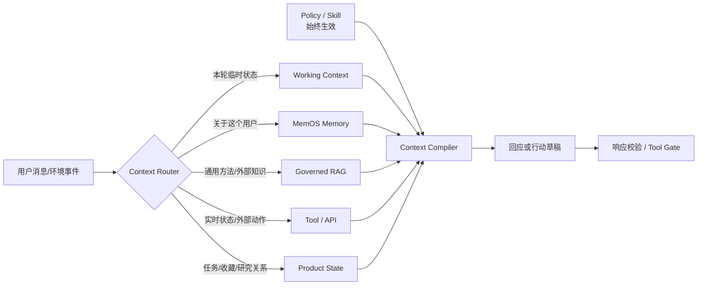
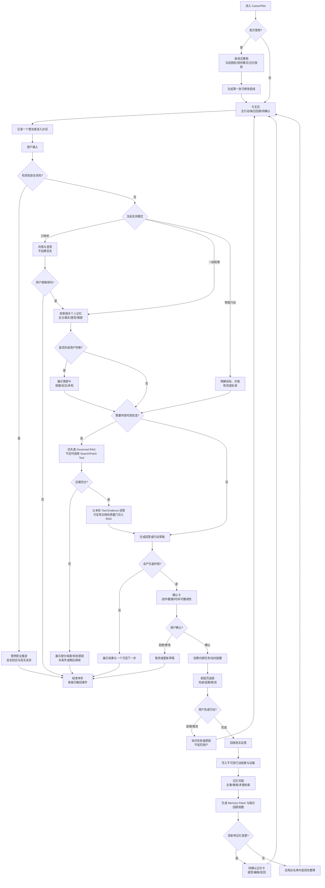
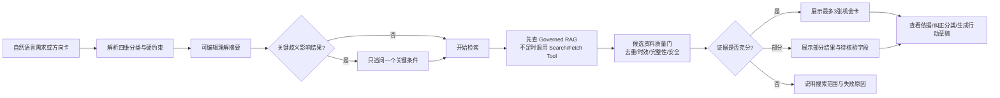
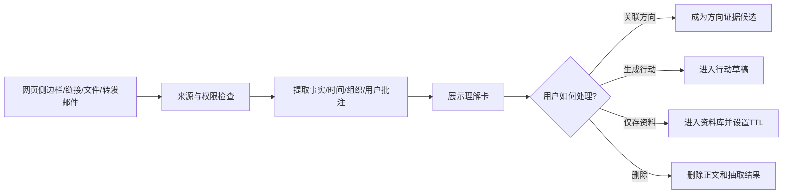
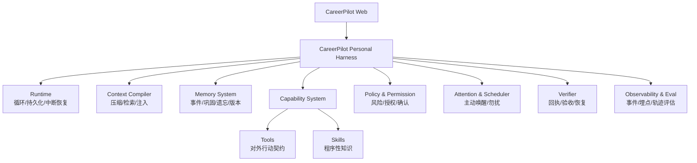

# CareerPilot 就业陪伴 Personal Agent｜MVP 产品需求文档

> 历史设计稿：该文档保留完整研究、交互与技术讨论，不再作为当前 MVP 的唯一范围基线。
> 当前精简产品基线见 [CareerPilot-MVP-PRD-v1.0](./CareerPilot-MVP-PRD-v1.0.md)，
> Harness 技术边界见 [CareerPilot Harness Architecture](../docs/architecture/careerpilot-harness.md)。

> 文档版本：v0.5  
> 文档状态：MVP 评审稿  
> 面向对象：产品、设计、研发、测试、运营  
> 配套文档：[CareerPilot Memory、Dreaming、RAG 与 Personal Action Fabric 技术设计](./CareerPilot-Memory-RAG-Technical-Design.md)

---

## 0. 产品摘要

CareerPilot 是一款面向**职业方向尚未收敛、需要长期探索的高校学生与毕业早期青年**的就业陪伴 Personal Agent。

它不以“尽快推荐更多岗位”为第一目标，而是帮助用户完成两件长期发生、彼此影响的事：

1. **慢慢摸清自己适合什么**：把零散想法、现实体验、偏好、顾虑和尝试结果组织成可修正的职业认知；
2. **在不确定和焦虑中持续行动**：先接住情绪，再把模糊想法转成一个低压力、可验证的小行动，并根据结果调整方向。

MVP 核心闭环：

```text
随手表达 → 被理解与整理 → 形成可验证猜想 → 用户授权一个小行动
→ Agent搜索/记录/提醒 → 用户反馈现实结果 → 记忆巩固与方向更新 → 每日回顾
```

最小价值不是“给出一次正确职业答案”，而是让用户在 4 周内形成一条**有证据、可回看、可纠正、正在推进的职业探索航线**。

---

## 1. 需求背景

### 1.1 用户问题是长期认知形成

职业未定用户会在产品岗、国央企、考公等方向间摇摆；收藏很多信息却无法关联自身；受挫又会改变偏好和行动强度。产品对象因此是一个持续变化的人，而不是一张简历；任务是管理数周或数月的探索过程，而不是回答一次问题。

### 1.2 调查与研究证据

现有证据可以支持“方向不清晰、规划模糊、焦虑与职业未决相关”这三个判断，但不能直接证明 CareerPilot 的所有具体功能都成立。

| 证据 | 样本与结果 | 支持的产品判断 | 局限 |
|---|---|---|---|
| 中国青年报·中青校媒，2023 | 覆盖全国 478 所高校、10,095 名大学生；73.39% 将“如何找准人生方向”列为大学阶段主要困惑 | 方向探索不是少数人的临时问题，适合作为前置需求 | 问题范围是“人生方向”，宽于职业方向；非全国概率抽样 |
| 中国青年报·中青校媒，2019 | 700 余名大学生和毕业生中，22.92% 有明确职业蓝图，71.49% 有方向但计划模糊，5.59% 完全没有规划；在规划不明确者中，61.54% 表示求职时才发现选择迷茫 | “有模糊方向但不能行动”比“完全没想法”更典型；支持把服务时间提前到求职季之前 | 样本量有限且时间较早，不作为当前全国比例估计 |
| 同一调查，2019 | 64.88% 认为职业规划能提供“提前试错、及时调整目标方向”的机会 | 支持用低成本现实行动获得证据，而不是一次测评给结论 | 这是受访者态度，不是干预后的因果效果 |
| OECD PISA 2022 / 2024 分析 | OECD 国家约五分之二的 15 岁学生没有清晰职业计划；对约 7 万人的 19 项纵向分析中，15 项发现青少年有清晰计划与之后更好就业结果相关 | 职业不确定具有长期影响，职业发展应持续发生 | 国际数据且年龄低于核心用户，只能作为间接证据 |
| 2026 年职业未决元分析 | 汇总 65 项量化研究、82 个样本、33,968 人；焦虑和情绪困扰与更高职业未决相关，职业决策自我效能等与更低职业未决相关 | 情绪不是附加模块，会影响用户是否能做出和推进职业决策 | 以相关研究为主，样本文化背景不完全等同于中国大学生 |
| 教育部转载就业工作调研，2024 | 对 18 所高校的 1,829 份问卷显示，学生除稳定和薪资外，也同时考虑工作生活平衡、成长、城市和兴趣 | 职业选择是多约束权衡，不应只按岗位名称或薪资匹配 | 报道未提供各因素完整比例与量表，主要支持问题结构 |

证据支持“方向与计划模糊、决策包含多重约束、焦虑影响职业未决”；仍需验证用户是否愿意长期记录、授权情绪记忆，以及记忆巩固、每日回顾和提醒能否提升 4 周行动闭环。M0 使用 12—15 人访谈和 4 周测试验证，不能用宏观调查代替产品研究。

### 1.3 现有产品覆盖的空白

现有求职产品主要优化三个局部环节：招聘平台优化岗位匹配、沟通和投递；题库/社区优化笔面试准备；通用 AI 优化文案生成和即时问答。

这些能力对“方向尚未确定”的用户存在共同缺口：

- 以明确意图为前提，难以承接“我也不知道想做什么”；
- 记录结果，不记录用户为什么改变；
- 提供建议，不持续观察建议是否有效；
- 关注效率，不处理焦虑导致的停滞、回避和选择瘫痪；
- AI 多为单点增强，缺少跨会话的长期状态、授权和验收。

### 1.4 竞品分析与 Agent 机会

调研聚焦 AI 在既有求职或陪伴流程中的位置，而非罗列功能。

| 产品类型（代表） | AI 的主要作用 | 已解决 | 仍未解决 |
|---|---|---|---|
| 招聘平台（BOSS、LinkedIn、Indeed） | 搜索、匹配、档案增强与流程辅助 | 提高人岗连接效率 | 长期职业认知与情绪变化 |
| 求职训练（牛客） | 模拟面试、个性化提问与反馈 | 降低练习成本 | 默认用户已有明确方向 |
| 求职 Agent（智联/职悟空） | 匹配、提醒与流程推进 | 缩短意图到行动的路径 | 可纠正的认知演化不是核心 |
| 求职工作台（Careerflow、Huntr） | 简历、申请追踪与面试准备 | 提高材料和流程效率 | 方向形成与陪伴不足 |
| 情绪陪伴（Wysa） | 对话支持、练习与安全分级 | 降低表达门槛 | 不处理职业事实和现实行动 |

CareerPilot 不竞争岗位供给，而是补齐三项组合能力：跨会话维护“为什么改变”；依据情绪与认知状态安排低风险行动；跨 App 执行并读取结果。故产品必须具备 `推理 + 持久状态 + Memory + Agentic RAG + 工具 + 环境反馈 + 验收`，并按风险分级授权，而不是追求全自动。

---

## 2. 产品对象

### 2.1 核心用户

**18—26 岁、处于毕业前 1—2 年至毕业后 2 年、职业方向尚未收敛的探索型求职者。**

典型特征：

- 大二至大四开始考虑实习、考研、考公、国央企或市场化就业；
- 应届或毕业早期，经历方向摇摆、跨专业尝试或求职受挫；
- 有行动意愿，但容易因信息过多、焦虑或目标模糊而停滞；
- 愿意通过对话记录想法，并接受低风险提醒和任务协助；
- 需要陪伴，但不希望被说教、诊断或替代决策。

### 2.2 首个聚焦切口

MVP 优先服务：**尚未确定求职方向、正在同时探索 2—3 条路径的高校高年级学生**。

选择原因：方向冲突明显；校招、实习、宣讲会有明确时间和可执行行动；4 周内能够观察“输入—行动—反馈—认知变化”。

### 2.3 次级用户

- 毕业 1—2 年、对第一份工作不满意但尚未决定转向的人；
- 跨专业或跨行业探索者；
- 在考公、考研、就业之间长期摇摆的用户。

### 2.4 暂不优先服务

- 已有明确目标、只需要批量投递或刷题的人；
- 中高阶职业经理人的猎头和薪酬谈判场景；
- 需要临床心理诊断、治疗或危机干预的人；
- 希望 Agent 未经确认自动投递、代聊招聘者或作出重大职业决定的人。

### 2.5 用户 Job-to-be-Done

> 当我对未来方向没有把握、脑中又不断出现小想法时，我希望有一个长期了解我的助手，先帮我把情绪和想法放稳，再把它们连接为可验证的方向，陪我做一点现实行动，让我逐渐知道自己适合什么，而不是替我给出武断答案。

### 2.6 用户可感知结果

4 周后，用户应能：

- 说清当前 1—3 条候选方向及各自依据；
- 看见哪些是事实、哪些只是猜想、还缺什么证据；
- 完成至少 3 个低成本现实探索行动；
- 回看自己的偏好、情绪和决策如何变化；
- 感到探索过程可控，而不是被 AI 推着走。

---

## 3. 产品定位

### 3.1 一句话定位

**CareerPilot 是帮助职业未定青年把零散想法变成职业认知、把焦虑变成可承受行动的长期就业陪伴 Personal Agent。**

### 3.2 产品类别

不是招聘平台、简历工具或心理咨询产品，而是位于三者之间的：**职业探索与行动管理 Agent**。

### 3.3 核心差异

| 常见 AI 求职助手 | CareerPilot |
|---|---|
| 围绕一次搜索、简历或面试 | 围绕一个人的长期职业探索目标 |
| 记录聊天或静态偏好 | 维护事实、经历、猜想、证据与行动结果 |
| 提供答案或推荐 | 主动提出低风险验证行动并追踪反馈 |
| 情绪安慰与任务执行割裂 | 情绪状态直接影响推进时机和行动强度 |
| 个性化来自档案字段 | 个性化来自可纠正的长期认知演化 |

---

## 4. 产品目标与非目标

### 4.1 MVP 目标

在 8—10 周内验证：

1. 用户愿意持续输入职业相关的想法、情绪和经历；
2. 可纠正的记忆与猜想卡能提高“被理解感”和方向清晰度；
3. 经授权的小行动、提醒和复盘能提高现实探索完成率。

### 4.2 MVP 非目标

- 不建设完整招聘平台或岗位供给池；
- 不做自动投递、代聊 HR、自动发邮件等外部高风险动作；
- 不做临床心理诊断或治疗；
- 不做一次测评生成唯一职业答案；
- 不建设复杂多 Agent 团队；
- 不做原生移动端和商业支付闭环。

---

## 5. 核心产品闭环

### 5.1 首次进入：不做长问卷

用户只需回答三个渐进问题：最近最困扰的职业问题；此刻需要倾听、梳理还是行动；允许系统记住什么、何时提醒。系统生成可修改的“当前航线”草稿。

### 5.2 情绪慰藉与支持模式

情绪陪伴不是一个独立心理咨询 Agent，也不是给理性建议套一层温柔语气。只要本轮出现明显失落、焦虑、自我怀疑、过载或摇摆，Agent 必须在第一段先提供**具体、可信、基于当前处境的慰藉**，再判断用户能够和愿意走到哪一步：

```text
即时慰藉 → 准确理解 → 恢复一点掌控感 → 用户选择暂停/梳理/探索/行动
```

#### 5.2.1 慰藉前置响应契约

首段慰藉需要同时做到：承认具体处境与感受；说明这种反应为何可以理解；把一次结果与用户的价值、能力和长期未来分开；告诉用户不需要立刻解决全部问题。慰藉必须引用本轮事实或用户已确认的支持偏好，禁止使用“你超棒”“一切都会好的”等无法由事实支持的空洞话术。

若用户明确说“不要建议”“只听我说”，本轮不得在结尾变相添加计划、任务或工具入口。每轮最多追问一个容易回答的问题，也允许不追问、给用户留白。

#### 5.2.2 四种支持模式

| 模式 | 适用状态 | 产品响应 | 工具边界 |
|---|---|---|---|
| 倾听 `listen` | 用户想倾诉、明显过载或拒绝建议 | 慰藉、反映感受、陪伴，不急于解释 | 禁止搜索、任务、日历和外部写入 |
| 梳理 `organize` | 用户希望看清发生了什么 | 区分事件、感受、担忧、证据、猜想与未知 | 可检索相关 Memory，不对外写入 |
| 探索 `explore` | 用户愿意讨论摇摆与矛盾 | 呈现两面动机、价值、约束和待验证假设 | 仅在有帮助且告知用户时做只读研究 |
| 行动 `act` | 用户主动要求或接受下一步 | 先简短慰藉，再给一个低压力行动 | 先出草稿；外部写入必须确认 |

慰藉是四种模式的共同底层能力，模式只决定慰藉之后走到哪里。负面情绪不自动禁止行动，用户当前明确要求高于历史支持偏好；Agent 也不能因为存在一个“有用任务”就自行推断用户已经准备行动。

该能力由项目 Skill [`career-emotional-support`](../skills/career-emotional-support/SKILL.md) 定义可复用行为契约，并由 Personal Harness 的情绪状态、Tool Filter、记忆策略和响应校验共同执行。

### 5.3 从小想法到认知图谱

```text
原始想法/经历 → 事件卡 → 主题聚类 → 猜想卡
→ 支持/反驳/待验证证据 → 候选方向 → 实验行动
→ 现实反馈 → Memory Consolidation形成可追溯的认知更新
```

产品不展示复杂知识图，而以“方向—依据—矛盾—下一步”的卡片和时间线呈现。

### 5.4 主动行动

Personal Agent 的“行动”不是多发一条提醒，而是把用户的一句模糊意图推进到现实世界，并读取结果。MVP 使用以下闭环：

```text
识别可行动意图 → 生成行动草稿 → 用户确认动作、时间和权限
→ 执行内部任务/外部日历写入 → 读取工具回执 → 到时提醒
→ 用户完成/延期/取消 → 回收现实反馈 → 更新证据、方向和记忆
```

MVP 支持六类行动，不把“行动”等同于日历：

1. **捕获行动**：从当前网页、用户转发邮件或上传文件中提取机会和想法，变成有来源的事件卡；
2. **研究行动**：主动搜索并核验宣讲会、招聘批次、报名截止时间，整理成不超过 3 个可选结果；
3. **计划行动**：把“改天看看国央企”改写为有完成标准的 15—30 分钟探索任务；
4. **产出行动**：建立岗位比较表、访谈提纲、资格核验清单或简历修改草稿，并保存版本；
5. **协调行动**：经确认后写入 CareerPilot 任务，并可同步日历、准备邮件草稿或发送低敏提醒；
6. **反馈行动**：读取日历/消息回执，询问“完成/延期/取消”和一个轻量发现，将现实结果转为 Evidence。

Agent 不把“工具请求已发送”视为完成，必须获得外部 `event_id` 或等价回执；回执失败时保留内部任务并提示同步失败。默认不投递简历、不代发消息给招聘者、不报名、不修改第三方已有日程。

### 5.5 记忆巩固与每日回顾

Dreaming 是 Memory System 内部的记忆巩固（Memory Consolidation）过程，定期将新增对话、行动和现实反馈去重、聚类、检查矛盾，再产生可追溯的 Memory Patch。它不是独立功能目录，也不等于每日总结。

“每日回顾”是该过程在“今天”页的用户可见视图，仅展示今日重要经历、新想法、已完成行动和明日的一个可选步骤。回顾内容可编辑，但用户看到或保存回顾不等于职业偏好、方向或人格结论已进入稳定记忆；这类高影响变更仍需单独确认。

### 5.6 Context、Memory、RAG、Policy 与 Tool 的边界

CareerPilot 不以“能否向量检索”判断信息归属，而以信息在产品中承担的责任判断。原始聊天可以存档，但不等于长期 Memory；能够检索的内容也不一定属于 RAG。

| 判断问题 | 应进入 | CareerPilot 示例 | 生命周期与控制 |
|---|---|---|---|
| 只描述本轮、尚未稳定吗？ | Working Context | 此刻焦虑、刚说过的细节、临时选择“只听我说” | 随 thread 保存，短期 TTL；不自动成为人格判断 |
| 是关于“这个用户”的跨时间事实吗？ | MemOS Personal Memory | 称呼、重要经历、长期目标、反复偏好、关系边界、被证实有效的安抚方式 | 用户可见、可纠正、可删除；候选/确认/过期分级 |
| 是对多人可复用的方法或外部知识吗？ | Governed RAG | 倾听式回应方法、职业路径、Agent 技术资料、岗位能力模型 | 有来源、版本、审核和时效；不承担用户身份连续性 |
| 是无论是否检索到资料都必须遵守的吗？ | Policy / Skill | 负面情绪先慰藉、安全分流、禁止空洞鸡汤、工具确认规则 | 版本化、始终生效；模型和 RAG 不得覆盖 |
| 是正在变化的外部状态或现实动作吗？ | Tool / API | 当前岗位是否在招、日历空闲、报名状态、创建提醒 | 调用时获取或执行，以回执为准；不得用旧 Memory 冒充 |
| 是确定性的产品业务状态吗？ | PostgreSQL Product State | 任务状态、收藏、研究进度、资料关联、权限和审计 | 结构化读写、可事务与回滚；不是 Memory 或 RAG |

同一句信息可能因**来源和责任**不同而走不同路径。例如“这家公司节奏很快”：若是用户过去的亲身经历，它是候选 Episodic Memory；若来自公司或行业报告，它是 RAG 证据；若询问当前团队实时情况，应通过 Tool/API 或新的外部研究核验。系统不得把这三者混成同一条“记忆”。

#### 5.6.1 Personal Memory：维持“它仍然是它”

MVP 的长期记忆分为六类：

1. **Profile Memory**：称呼、稳定背景、长期约束；
2. **Relationship Memory**：用户与 Agent 的称呼习惯、共同经历和互动连续性；
3. **Episodic Memory**：重要经历、近期挫折、行动及现实反馈；
4. **Boundary / Support Memory**：用户明确不喜欢的回应方式、禁区，以及被用户确认有效的支持偏好；
5. **Goal Memory**：长期目标、正在验证的方向和用户授权的跟进承诺；
6. **Safety Memory**：仅保存用户授权且确有后续保护价值的最小信息，不保存泛化诊断或用永久标签定义用户。

一次情绪只进入 Working Context 或短期 Episode；“用户不喜欢鸡汤式安慰”只有在用户明确表达或多次反馈并确认后，才进入 Boundary / Support Memory。通用的“怎样倾听、怎样帮助复盘”不属于用户记忆。

#### 5.6.2 RAG：提供方法与事实，不伪装成“懂你”

Governed RAG 包含两组一级知识域：

1. **陪伴支持 `companion_support`**：经过审核的倾听式回应、压力复盘、沟通练习、认知重构、睡眠放松和危机资源说明。RAG 提供可选方法与依据；必须先慰藉、安全分流等不变规则仍由 Policy/Skill 执行。
2. **职业知识 `career_knowledge`**，下设三个可交叉标注的子域：
   - `career_world`：公务员、选调、事业单位、国央企、民企、外企等路径、进入机制、组织属性和用工关系；
   - `domain_knowledge`：进入某一专业领域需要掌握的知识，例如 Agent 岗的 LLM、RAG、Memory、Harness、MCP、评估方法、官方文档和论文；
   - `role_market`：产品经理、Agent 产品经理、AI 工程师等岗位的职责、能力模型、JD、面试知识和市场变化。

同一资料可以拥有多个标签。例如 Agent 产品经理 JD 同时属于 `career_knowledge/domain_knowledge:agent_system` 和 `career_knowledge/role_market:ai_product_manager`。标签服务检索与评估，不替代来源证据。

#### 5.6.3 自动摄取与研究视图

CareerPilot 不要求运营持续手工灌库。Agent 根据目标发现知识缺口，先复用已审核 RAG；不足、过期或冲突时才联网检索。实时搜索结果先作为本次 Run 的 Tool Evidence，只有具有复用价值、可回源、通过质量门且完成版本/时效标注的文档，才进入 RAG：

```text
识别知识缺口 → 检索 Governed RAG → 判断充分性
→ 必要时调用 Search/Fetch Tool → 候选隔离与质量检查
→ 本轮以 Tool Evidence 回答 → 可复用文档切分、索引和发布
→ PostgreSQL 记录用户与资料的研究关系 → 到期刷新或退出活跃索引
```

搜索摘要、无法打开的网页、无来源生成文本和低可信聚合内容不得直接入库。用户看到的“研究”页是 PostgreSQL Product State 的可视化：展示资料引用、知识缺口、阅读状态和与目标/猜想的关系，不是第二套 Memory，也不复制公共正文。收藏或阅读只能更新研究状态；只有后续出现明确、稳定且有证据的用户事实，并通过 Memory Policy，才能另建 Memory 候选。

#### 5.6.4 每轮上下文装配

```text
始终生效的 Policy/Skill
+ 本轮 Working Context
+ 按用途召回的 Personal Memory
+ 按问题召回且带来源的 RAG
+ 本次 Tool/API 的新鲜结果
+ 必要的 Product State
→ 生成回应/行动草稿 → 响应与工具验收
```



Memory 提供“为什么这句话适合这个人”，RAG 提供“有什么可靠方法与事实”，Tool/API 提供“此刻世界怎样”，Policy/Skill 保证“无论模型怎样推理都不能越过什么边界”。

### 5.7 就业机会分类体系

#### 5.7.1 为什么不能使用单层“岗位分类”

用户常把“公务员、选调生、国企、产品经理、有编制”放在同一层讨论，但它们分别回答不同问题：

| 维度 | 回答的问题 | 例子 |
|---|---|---|
| 就业去向/组织属性 | 去什么类型的组织 | 党政机关、事业单位、央企、民营企业 |
| 进入途径 | 通过什么机制进入 | 国考、省考、选调、公开招聘、校招 |
| 身份/用工关系 | 与谁建立什么关系 | 公务员、事业单位聘用、企业直签、劳务派遣 |
| 职业职能 | 实际从事什么工作 | 专业技术、办事行政、生产制造、生活服务 |

因此 CareerPilot 不建立互斥的单棵分类树，而使用四维标签组合。一条机会必须至少标注“就业去向 + 进入途径 + 用工关系”；有可靠信息时再映射国家职业分类代码。

#### 5.7.2 第一维：就业去向/组织属性

| 产品一级类目 | 二级类目 | 官方口径与产品说明 |
|---|---|---|
| 党政机关与参公单位 | 中央机关及其直属机构；地方各级机关；参照公务员法管理单位 | 公务员录用受《公务员法》和《公务员录用规定》约束；“国考”是中央机关及其直属机构考试录用的通俗简称 |
| 事业单位 | 教育、卫生、科研、文化及其他事业单位 | 《事业单位人事管理条例》规定新聘人员原则上面向社会公开招聘，并订立聘用合同 |
| 国有及国有控股企业 | 国务院国资委监管中央企业；地方国有/国有控股企业；其他可核验国有控股企业 | “央企”必须依据国资委等官方名录或权属信息核验；不能仅凭企业名称判断 |
| 其他企业 | 私营企业；港澳台投资企业；外商投资企业；其他内资企业 | 参考国家统计局《市场主体统计分类的划分规定》；“股份有限公司”不当然等于国企或民企，仍需查看控制权 |
| 社会组织及非营利机构 | 社会团体、基金会、社会服务机构等 | 与党政机关、事业单位、企业分开标记，具体身份以登记信息与招聘公告为准 |
| 国防与军队 | 军队文职；参军入伍；军官/军士等 | 国家职业分类将军队人员单列；不同路径的身份、条件和服务期限不同 |
| 自主创业与灵活就业 | 个体经营、自由职业、平台就业、创业 | 不伪装成传统“岗位”；记录收入方式、稳定性、社保和客户来源等约束 |

产品展示时可将“国央企”作为用户熟悉的聚合入口，但筛选结果必须继续拆成“央企/地方国企 + 直接合同/派遣/外包 + 具体职能”。

#### 5.7.3 第二维：进入途径

| 路径大类 | 具体途径 | 适用说明 |
|---|---|---|
| 公务员考试录用 | 中央机关及其直属机构考试录用（国考）；地方公务员考试录用（省考等） | 面向相应机关职位；以当年度官方公告和职位表为准 |
| 选调生 | 定向选调、集中/普通选调等地方项目 | 面向符合各省公告条件的优秀毕业生到基层培养；不是与公务员并列的企业岗位类别 |
| 事业单位招聘 | 统一/分类公开招聘、单位公开招聘、合规人才引进 | 均需核对招聘公告、岗位备案、聘用范围与是否纳入编制管理 |
| 国企招聘 | 校园招聘、社会招聘、专项招聘、人才引进、实习转录 | 招聘渠道本身不能证明直签关系，必须读取合同主体和用工说明 |
| 市场化企业招聘 | 校招、社招、实习转正、猎头/内推 | 适用于民营、外商投资、港澳台投资及其他企业 |
| 基层服务项目 | “三支一扶”、特岗计划、西部计划等 | 属于政策性服务项目，不应直接标记为公务员或事业编；服务期和后续政策按当年文件展示 |
| 国防招录 | 军队文职公开招考、直接选拔招录、参军入伍等 | 按官方公告区分文职人员和现役军人身份 |
| 自雇路径 | 个体工商登记、自由职业、创业项目 | 记录准入、资金、社保和经营风险，不使用“录用”状态 |

“公开遴选/公开选调公务员”主要面向已经具备公务员等相应身份的在职人员，不放入应届生默认入口；只有用户符合条件时才展示。

#### 5.7.4 第三维：身份与用工关系

| `employment_relation` | 用户展示名 | 判断依据 | 产品提示 |
|---|---|---|---|
| `civil_servant` | 公务员 | 公务员录用公告、职位表与录用手续 | 属于机关编制管理，不与企业“正式工”混称 |
| `public_institution_staffed` | 事业单位编制内聘用 | 公告明确纳入事业编制/办理入编或同等官方表述 | 同时仍需订立事业单位聘用合同 |
| `public_institution_nonstaffed` | 事业单位编外/合同制 | 公告明确编外、员额外或劳动合同制 | 不得因单位是事业单位就标成“有编制” |
| `direct_labor_contract` | 用人单位直接签订劳动合同 | 招聘主体与劳动合同用人单位一致 | 企业基本用工形式；固定期限不等于没有正式关系 |
| `labor_dispatch` | 劳务派遣 | 与派遣单位签劳动合同，在用工单位工作 | 《劳动合同法》规定派遣单位是用人单位，派遣是补充用工形式 |
| `service_outsourcing` | 外包服务岗位 | 与承包/服务商建立关系，由其交付服务 | 不应展示为在目标单位直接任职，需显示真实合同主体 |
| `non_full_time` | 非全日制用工 | 以小时计酬并符合相应法定条件 | 单独展示工时、社保和终止规则 |
| `project_service` | 基层项目服务身份 | 项目协议和当年度政策文件 | 不自动等同公务员、事业编或劳动合同直签 |
| `self_employed` | 自雇/个体经营 | 个体登记或实际自雇关系 | 展示收入和保障的不确定性 |
| `unknown` | 用工关系待核验 | 公告未明确或来源不可信 | 不猜测，提示用户在签约前确认合同主体 |

**关于“国央企有编制/无编制”的产品纠偏：**

- 行政编制和事业编制适用于机关、事业单位的法定管理语境；
- 国有企业依据《劳动合同法》与职工建立劳动关系，企业可能有内部“定岗定员、正式员工、市场化用工”等口径，但不存在全国统一的“央企编制”法定身份；
- 因此 CareerPilot 不显示笼统的“国企有编/无编”，而显示**直接劳动合同、劳务派遣、外包服务、非全日制或待核验**；
- 如果招聘公告出现“正式编制”等内部措辞，只能作为 `internal_headcount_note` 原文展示，不能替代法定用工关系字段；
- “直签”也不等于终身稳定，仍需展示合同主体、期限、试用期和岗位地点。

#### 5.7.5 第四维：职业职能

底层优先映射《中华人民共和国职业分类大典（2022年版）》职业代码。大典最终发布版本包含 8 个大类、1,639 个职业：

1. 党的机关、国家机关、群众团体和社会组织、企事业单位负责人；
2. 专业技术人员；
3. 办事人员和有关人员；
4. 社会生产服务和生活服务人员；
5. 农、林、牧、渔业生产及辅助人员；
6. 生产制造及有关人员；
7. 军队人员；
8. 不便分类的其他从业人员。

用户界面可以使用更易懂的职能标签，如研发/技术、产品/项目、运营/市场、财务/金融、法律/合规、行政/人力、教育/科研、医疗健康、生产/工程、销售/服务等，但必须维护其到国家职业代码的映射；无法可靠映射时标为待分类，不由模型自行编造职业代码。

#### 5.7.6 机会卡展示与筛选

每张机会卡至少展示：

```text
组织：某中央企业子公司（权属来源：国务院国资委名录 + 企业官网）
途径：2027届校园招聘
职能：信息和通信工程技术人员 / 产品方向
用工关系：公告未明确，待签约前核验合同主体
地点与时间：上海｜截止 2026-11-15
来源：企业招聘官网｜抓取时间｜验证状态
```

筛选器按四维分别展示，不把“稳定”直接等同于“体制内”。稳定性是用户偏好与岗位事实综合形成的评价维度，不能替代组织属性或用工关系。

#### 5.7.7 分类置信度与来源规则

- `verified`：招聘公告、政府/国资委名录、登记信息能够直接支持；
- `partially_verified`：组织属性可确认，但进入途径或用工关系未明确；
- `user_confirm_needed`：需要用户从 offer、合同或招聘方获取信息；
- `conflicted`：多个权威来源冲突，必须并列展示；
- 禁止仅凭“国字头”“集团”“事业部”“正式岗”等文字推断组织属性或编制；
- 每个分类字段保存独立来源，不能用一个企业官网链接为所有字段背书。

---

## 6. MVP 功能需求

### 6.1 P0 功能

| 编号 | 功能 | 用户价值 | 核心验收 |
|---|---|---|---|
| F1 | 渐进式建档 | 低压力地开始被理解 | 3 分钟内完成；可跳过；不超过 3 问 |
| F2 | 情绪慰藉与长期陪伴对话 | 随时表达小想法和焦虑，并及时获得具体慰藉 | 负面情绪首段先慰藉；区分倾听/梳理/探索/行动；记忆可溯源 |
| F3 | 职业猜想卡 | 把感觉变成可验证假设 | 显示支持/反证/置信度；可驳回 |
| F4 | 方向罗盘 | 看见候选方向及其变化 | 同屏最多 3 条；不输出唯一结论 |
| F5 | 行动闭环与日历协同 | 推进到现实验证 | 创建前确认；飞书/ICS 可选；读取回执；可延期/取消；回收结果 |
| F6 | 动态 RAG 与机会搜索 | 获得经审核的陪伴方法和可追溯职业知识，同时保持个性化边界 | 区分陪伴支持/职业知识；优先复用 RAG；实时事实走 Tool；可复用文档通过质量门后入库 |
| F7 | 记忆中心 | 掌握 Agent 对自己的理解 | 可查看、编辑、删除、纠正和清空 |
| F8 | 每日回顾 | 看见当天的经历、想法与行动 | 每日一份；可编辑；不自动晋升高影响记忆 |
| F9 | 安全与隐私 | 保持表达安全感 | 记忆开关、撤回、分级和风险响应 |
| F10 | Personal Inbox | 从工作现场把信息交给 Agent | 网页/链接/文件/转发邮件可进入；来源透明；保存前确认 |

### 6.2 关键功能规则

#### 长期陪伴对话

- MVP 仅文本；语音、图片和文件放到 P1；
- 事实、猜想、外部资料采用不同视觉标识；
- “为什么这么说”展示所用记忆和外部来源；
- 检测到负面情绪时，回复首段必须先慰藉，不得先分析原因、输出计划或调用工具；
- 慰藉需要关联本轮具体事件，不使用空洞鼓励，不许承诺未来一定变好；
- 用户说“只听我说”后，本轮不得创建任务、搜索或在末尾变相建议行动；
- 用户可直接选择“先陪我一下 / 一起理一理 / 帮我往前走一步”，系统推断的模式始终可改；
- 当前明确请求覆盖历史支持偏好，例如用户说“不要安慰，直接复盘”时进入梳理；
- 情绪状态只影响本轮节奏；短期情绪不得直接成为人格、职业偏好或稳定 Memory。

#### 职业猜想卡

字段：猜想、置信度、支持证据、反对证据、待验证问题、更新时间。用户可确认、部分同意、驳回、补充证据或暂不判断。驳回后不得作为稳定画像使用。

#### 小行动与提醒

任务必须包含：为什么做、预计用时、开始/截止时间、完成标准、提醒方式、同步目标、取消入口。单次只突出一个主行动；默认行动成本不超过 30 分钟。

- 内部 `action_id` 是唯一事实源，外部日历只保存 `action_id` 与回到 CareerPilot 的深链，不存储情绪、猜想或敏感记忆；
- 创建外部日程前展示确认卡：标题、时间、提醒频率、写入 App、将发送的数据和撤销方式；
- 首次使用飞书需要 OAuth 授权；后续仍需对每次写入进行确认，MVP 不申请长期静默写权限；
- 修改/取消内部任务时，先询问是否同步更新外部日程；外部修改冲突时不得覆盖，展示双方版本供用户选择；
- 到期提醒默认 1 次；用户连续两次延期后暂停催促，改为询问任务是否过大或方向是否变化。

#### RAG、实时检索与研究状态

- 每次研究先形成 `knowledge_gap`，说明缺少什么知识、服务哪个用户目标以及完成标准；不得为了“丰富知识库”无目的抓取；
- 检索顺序固定为“Governed RAG → 必要时 Search/Fetch Tool → 本轮证据 → 质量判断 → 可复用文档候选入库”，已有资料充分且有效时不得重复联网；
- 新资料默认进入候选隔离区，完成回源、去重、正文完整性、时效、相关性和提示注入检查后才可进入活跃索引；
- RAG 一级域包含 `companion_support` 与 `career_knowledge`；后者再按 `career_world / domain_knowledge / role_market` 多标签组织，并附适用人群、来源等级、版本和有效期；
- “负面情绪先慰藉”、安全分流和工具确认属于 Policy/Skill，不依赖 RAG 是否命中；实时岗位、截止时间和日历状态以 Tool/API 本次结果为准；
- 研究页只读取 PostgreSQL 的 `user_id + knowledge_item_id + goal/direction/hypothesis + interaction_status` 等确定性关系，不为每个用户复制公共文档，也不作为模型人格记忆；
- 用户浏览、收藏或关联资料不自动形成职业偏好；只有用户反应满足 Memory 写入规则时，才产生独立的 MemOS 候选；
- 时效资料到期后退出活跃召回，但保留最小版本与引用历史；再次需要时由 Agent 触发刷新，不静默用旧内容回答；
- 用户可查看资料为什么被使用、打开原始来源、标记无关或要求刷新；公共资料纠错与个人“不相关”反馈分开处理。

#### 机会搜索

MVP 优先覆盖“国央企校招与高校宣讲会”，但搜索结果必须按 5.7 的四维体系规范化。Agent 可拆解查询和换源，最多 3 轮；结果默认展示最匹配的 3 张卡片，其余结果由用户主动展开。

- 支持自然语言，例如“帮我找上海有编制的国企产品岗”。系统先解析为**去向、进入途径、用工关系、职业职能**以及地点/时间/学历等约束，再展示“我这样理解”的可编辑筛选摘要；
- 对会显著改变结果的歧义只追问一个关键问题；不影响首轮检索的缺失项先标记为未知，避免把用户带入长问卷；
- 用户说“国企有编制”时，系统说明企业并不存在全国统一的行政/事业编制口径，并提供“用人单位直签 / 劳务派遣 / 外包 / 暂不限定”四个可理解选项；
- 组织属性与用工关系分开核验。确认是央企不能推出“直签”，招聘渠道也不能推出合同主体；
- 每张卡必须展示组织属性、进入途径、职业职能、用工关系、地点/时间、字段级来源和验证状态。字段未知时显示“待核验”，不得补全；
- 用户可以修改任一分类，并选择“原公告就是这样写的 / 系统理解错误 / 我已向招聘方确认”。纠正只更新对应字段，不覆盖原始来源；
- 用户选择结果后，Agent 才能生成报名、参加宣讲会或核验合同主体的行动草稿；任何报名、投递和日历写入均不在 MVP 自动执行。

#### 记忆中心

按“我明确说过的”“Agent 的猜想”“经历与行动”“对我有效的支持方式”分组，不暴露底层向量字段。

#### 每日回顾

每日回顾不强制弹窗，在“今天”展示一份可编辑总结，包含重要经历、新想法、已完成行动和一个明日可选步骤。回顾由 Memory Consolidation 的结果投影生成，不与 Memory Patch 绑定提交；高影响记忆另行展示确认卡。

### 6.3 P1 候选

- 语音快速记录；
- Google Calendar、Outlook Calendar 双向同步；
- Gmail/Outlook 的用户指定招聘标签只读接入；
- OneDrive、Google Drive、飞书文档、Notion 的用户选定文件接入；
- 微信小程序分享入口、订阅消息与移动端系统通知；
- 移动端系统 Share Sheet；
- 简历版本管理和岗位适配分析；
- 模拟面试工具接入；
- 邮件发送、招聘平台动作等高风险连接器仅做逐次确认试验；
- 多模态材料理解；
- 用户自定义 Agent 人格与语气。

---

## 7. Web 信息架构与交互设计

### 7.1 信息架构

```text
今天：每日回顾、当前主行动、待确认事项
对话：倾听/梳理/行动的统一入口
收件箱：来自网页、链接、文件和转发邮件的待整理材料
罗盘：候选方向、猜想、证据与矛盾
研究：RAG 资料引用、知识缺口、阅读状态和来源更新（确定性产品状态，不是个人记忆）
航程：任务、提醒、行动结果和时间线
产出：岗位比较、提问清单、简历建议等版本化 Artifact
记忆：查看、纠正、删除、导出和清空
设置：App 连接、权限、通知、隐私和安全说明
```

全局采用左侧一级导航、中央主工作区、右侧上下文抽屉。右侧抽屉只在用户点击“为什么这么说”“查看依据”或任务详情时打开，避免持续占用注意力。

### 7.2 MVP 核心交互流程图



流程图中的关键原则：

- “只倾听”是一条可独立结束的完整路径，不强制汇入行动；
- 搜索和整理可以在无副作用时执行，任务、提醒、记忆晋升必须在对应确认点停下；
- Agent 执行后的终点不是“工具调用成功”，而是用户完成现实行动并反馈；
- 记忆巩固仅处理新增事件及其证据；每日回顾是用户视图，不代替 Memory Patch 的确认与提交；
- `partial` 和失败是正常产品状态，都要保留中间结果和恢复入口。

### 7.3 首次建档流程

| 步骤 | 页面内容 | 用户操作 | 系统反馈 | 可退出方式 |
|---|---|---|---|---|
| 1 欢迎 | 产品边界、记忆说明 | 开始/先体验 | 不要求填写简历 | 直接进入对话 |
| 2 当前困扰 | 单个开放问题 | 输入或跳过 | 提取候选主题，不下结论 | 跳过 |
| 3 陪伴模式 | 倾听/一起梳理/帮我行动 | 单选 | 立即影响首轮回复 | 随时修改 |
| 4 记忆授权 | 记忆开启范围和示例 | 开启/关闭/自定义 | 展示将记什么、不记什么 | 关闭长期记忆 |
| 5 第一张航线 | 当前问题、一个待验证猜想 | 确认/修改/暂不判断 | 进入“今天” | 返回修改 |

交互约束：每屏只做一个决定；不展示超过 3 个选项；进度用“1/4”而不是百分比制造完成压力；所有步骤可跳过。

### 7.4 对话页交互

对话页是主入口，但不是唯一承载状态的聊天框。

| 组件 | 交互 | 状态 |
|---|---|---|
| 模式切换 Chip | “只听我说 / 一起梳理 / 帮我行动” | 当前模式常驻可见，本轮可切换 |
| 输入框 | 文本输入、快捷记录想法 | 空闲/输入/发送中/失败重试 |
| Agent 回复 | 短段落 + 最多 3 个选项 | 生成中/完成/被撤回 |
| 慰藉反馈 | “这句话有帮助 / 不太对 / 先别安慰”轻反馈 | 未反馈/有帮助/需调整 |
| 猜想卡 | 查看依据、确认、部分同意、驳回 | 待判断/已确认/已驳回/有冲突 |
| 行动草稿卡 | 查看为什么做、耗时、截止时间 | 草稿/等待确认/已创建 |
| 工具进度条 | 显示搜索、核验、整理，不展示思维链 | 进行中/部分结果/失败/完成 |
| 溯源入口 | 展开 Memory 与外部来源 | 收起/展开/来源失效 |

关键交互：

1. 用户发送后 300ms 内显示接收状态；超过 1.5 秒显示“正在理解/查找”，而非无限加载；
2. Agent 判断需要行动时，先输出行动草稿卡，主按钮为“确认创建”，次按钮为“改一下”，不能直接产生副作用；
3. 用户选择“只听我说”后，页面隐藏行动型快捷按钮，回复末尾不出现任务建议；
4. 用户驳回猜想时弹出可选原因：不准确/已经变化/不想保存/其他；操作后卡片立即变灰并提示“不再用于后续建议”；
5. 出现负面情绪时，首屏优先显示慰藉段落，不让分析卡、任务卡或搜索进度抢在慰藉之前；
6. 慰藉后的选择最多 3 个，推荐文案为“先陪我一下 / 一起理一理 / 往前走一步”；用户选择“先陪我一下”后本轮不再展示行动按钮；
7. 长回复默认折叠在 240 字左右，保留核心慰藉、当前理解与用户控制入口。

### 7.5 “今天”页面交互

页面自上而下：情绪/想法快速入口、当前主行动、每日回顾、待确认记忆。

- 当前主行动只能有一个视觉主按钮；其他任务折叠到“查看航程”；
- 任务操作包括完成、延期、取消。点击完成后必须出现一个轻量反馈问题：“做完后你有什么新感受或发现？”；
- 每日回顾默认不弹窗，整份支持“补充一句/修改/保存”；其中的记忆变更另以确认卡呈现；
- 没有任务时显示“记录一个念头”，不显示“你今天还没完成任务”。

### 7.6 罗盘页面交互

罗盘以方向卡而不是复杂知识图谱为主视图。每张方向卡包含：方向名称、探索阶段、置信度文字标签、支持证据、反对证据、未知问题、最近变化、下一验证点。

- 同屏最多 3 张方向卡；
- 点击证据打开右侧抽屉，显示原始事件和时间；
- 用户可以手动新增方向，但删除方向不会删除底层事件；
- “置信度”使用低/中/较高并解释原因，不显示伪精确的 87%；
- 时间线允许对比“当时怎么想”和“现在为什么改变”。

### 7.7 机会搜索与分类交互

机会搜索既可以从对话中的一句话触发，也可以从罗盘方向卡点击“找现实机会”触发。搜索页使用渐进式筛选，不一次展示整套复杂分类。



#### 搜索前：理解摘要与筛选器

- 第一层只显示 3 个常用筛选 Chip：**去向、进入途径、用工关系**；“职业职能、地点、时间、学历”等收进“更多条件”；
- 摘要示例：“我理解你在找：上海｜央企/地方国企｜校招｜产品职能｜优先用人单位直签”；每个标签可单独删除或修改；
- “稳定”“体制内”“正式岗”等口语不能直接映射为唯一枚举，点击后打开解释抽屉，由用户选择其真正关心的是合同主体、期限、编制身份还是组织属性；
- 用户不确定时允许选择“暂不限定”，Agent 不得强迫作答。

#### 搜索后：机会卡

| 卡片区域 | 必须展示 | 交互 |
|---|---|---|
| 主信息 | 职位/活动名、组织、地点、截止时间 | 打开原始公告 |
| 分类标签 | 去向、途径、职能、用工关系 | 点击查看定义和依据 |
| 核验状态 | 已核验/部分核验/存在冲突；抓取时间 | 展开字段级来源 |
| 待核验项 | 如“合同主体未在公告说明” | 查看“如何向招聘方核验”清单 |
| 匹配解释 | 使用了哪些用户约束；不得使用未确认猜想 | 查看或关闭个性化依据 |
| 下一步 | 了解详情/生成行动草稿 | 不直接投递或创建日历 |

“编制/用工关系”解释抽屉必须包含：该术语在当前组织类型下的含义、原公告原文、CareerPilot 的标准化结果、仍需核实的问题。用户纠正后，卡片即时刷新并显示“由你修正”；系统保留原值、证据和纠正原因用于审计，但分析平台不记录原文。

#### 研究资料卡

Agent 在陪伴方法、职业、专业领域或投递岗位研究中使用过的资料，可进入用户“研究”页的引用列表。资料卡展示标题、RAG 域、为什么被本轮使用、支持/反驳的对象、来源等级、发布时间、最近验证时间和有效状态。用户可以“读过、收藏、与我无关、关联方向、要求刷新”。这些是确定性研究状态；不得用阅读或收藏行为直接推断职业偏好，也不得把陪伴方法写成用户的个人记忆。

### 7.8 Personal Inbox 交互

Personal Inbox 是 Agent 的跨 App 感知入口，不是又一个收藏夹。所有材料先进入 `待理解`，只有用户确认后才进入机会库、行动或长期记忆。



浏览器侧边栏默认展示当前页面的标题、URL、来源域名和三个操作：“这与我有关”“之后行动”“先收藏”。读取正文必须由用户点击触发；保存前展示将提取的字段。对于登录页面，只处理用户当前可见内容，不持久化 Cookie、密码和会话 Token。

转发邮件入口只接收用户主动转发的邮件，不扫描私人邮箱。系统识别面试时间、报名截止、组织和待办后先生成理解卡；附件默认不进入长期记忆。文件上传支持简历、JD 和公开公告，必须显示当前版本、来源和删除入口。

### 7.9 航程与行动交互

航程采用“草稿—待执行—等待反馈—已完成—已延期—已取消—同步异常”状态，不使用看板拖拽作为 MVP 必要能力。

```text
Agent提出行动草稿
→ 用户确认/修改/拒绝
→ 创建CareerPilot内部任务
→ 可选：写入飞书日历；未连接时下载ICS
→ 外部返回event_id才显示“同步成功”
→ 到期前通过站内或飞书机器人克制提醒一次
→ 用户完成/延期/取消
→ 完成后回收现实反馈
→ 更新证据和方向
```

任务详情必须显示：来源目标、为什么推荐、预计耗时、开始/截止时间、完成定义、提醒渠道、外部同步状态、最近一次同步时间、取消入口。延期后不批评用户；连续两次延期时询问任务是否太大，而不是继续催促。

飞书机器人提醒卡只提供 3 个主操作：**已完成、延后、打开 CareerPilot**。点击“已完成”后再展示一个可跳过的问题：“这次行动让你多知道了什么？”；不得在飞书消息中展示用户的情绪记忆或敏感职业猜想。

### 7.10 记忆中心交互

按“我明确说过的、Agent 的猜想、经历与行动、有效支持方式”分组。每条展示内容、来源、创建时间、最后使用时间和影响范围。

- 编辑：保留旧版本但后续只用新版本；
- 删除：二次确认后立即从产品视图消失，后台显示删除处理中/已完成；
- 清空：说明会失去哪些个性化能力，输入确认词后执行；
- 关闭长期记忆：不影响基础对话，但后续不创建新长期记忆；
- “为什么记住”：解释保存理由，不展示模型隐式思维链。

### 7.11 通用页面状态

| 状态 | 产品表现 | 用户动作 |
|---|---|---|
| 首次空态 | 解释页面用途 + 一个低压力入口 | 记录想法/开始探索 |
| 加载 | 骨架屏或阶段状态，超过阈值说明原因 | 可取消 |
| 部分成功 | 展示已获得结果与缺失项 | 补信息/稍后继续 |
| 工具失败 | 明确未完成，不伪造成功 | 重试/保留草稿 |
| 网络断开 | 保存本地输入，恢复后由用户确认重发 | 重新发送 |
| 来源失效 | 保留历史摘要但标记不可验证 | 重新搜索 |
| 权限待确认 | 展示动作、数据、范围、有效期 | 确认/修改/拒绝 |
| 安全风险 | 暂停职业功能，展示现实支持入口 | 联系支持/返回 |

### 7.12 视觉与无障碍

- 主色薄荷绿 `#68A88E`；事实灰蓝 `#87A8C2`；猜想浅琥珀 `#E8D4A8`；危险砖红 `#C97064`；
- 颜色不能成为唯一状态编码，配合文字与图标；
- 正文最小 16px，文本对比度满足 WCAG AA，键盘可完成主要流程；
- 动效 150—250ms，遵循系统减少动态效果设置；
- 不使用排行榜、连续签到、倒计时焦虑和空洞鸡汤。

---

## 8. Agent 产品系统设计

本章属于 PRD：它定义产品在什么状态下做什么、何时停下、谁确认、怎样算完成。Memory/RAG 的数据结构和代码实现放在配套技术设计文档。

### 8.1 场景与产品形态

| 场景 | Agent 角色 | 允许动作 | 用户控制点 |
|---|---|---|---|
| 情绪表达 | Copilot | 即时慰藉、倾听、复述、澄清 | 可锁定“只倾听”；可反馈慰藉是否合适 |
| 方向探索 | Copilot | 提出猜想、对比证据、设计实验 | 用户确认/驳回猜想 |
| 机会研究 | 有界 Delegated Agent | 拆查询、搜索、核验、排序 | 搜索无需确认；创建行动需确认 |
| 行动推进 | 有界 Delegated Agent | 建内部任务、写入日历、发送提醒、读取回执、回收反馈 | 每次外部写入前确认；可撤销、可断开连接 |
| 记忆巩固 | Memory System 后台职责 | 去重、聚类、发现冲突、提出 Memory Patch 并生成每日回顾视图 | 高影响更新需确认；回顾不等于记忆已提交 |

### 8.2 Personal Harness 产品边界

CareerPilot 不把模型本身当作 Agent 产品。模型只负责提出下一步意图；Personal Harness 负责维护长期状态、组装上下文、加载能力、检查权限、执行行动、验收结果和记录全程。



- **Tool** 定义 Agent 能对世界做什么，包含输入输出、权限、副作用、幂等、回执和失败降级。
- **Skill** 定义 Agent 如何完成一类任务，由说明、脚本、参考资源和可用 Tool 组成，按需渐进式加载。
- Tool 和 Skill 都由 Harness 的 Capability Registry 管理；Skill 不绕过 Tool 权限，也不直接对外执行。
- Dreaming 不是 Capability，而是 Memory System 内部的 Consolidation 阶段；它的调度由 Harness 负责，记忆决策由 Memory Policy 负责。

### 8.3 意图空间和优先级

| 意图 | 识别信号 | 产品响应 | 优先级 |
|---|---|---|---:|
| 安全风险 | 自伤、自杀、现实危险 | 停止职业推进，进入安全响应 | P0 |
| 情绪支持 | 明确难受、自我否定、过载、只想说说或不想听建议 | 首段即时慰藉，再按用户意愿倾听/梳理/探索/行动 | P1 |
| 记忆控制 | 查看、纠正、删除、关闭记忆 | 立即进入数据控制流程 | P1 |
| 职业探索 | “适合什么/怎么选/我是不是” | 猜想 + 证据 + 验证行动 | P2 |
| 机会研究 | 找岗位、宣讲会、政策 | 检索并核验 | P2 |
| 行动管理 | 提醒、创建、延期、完成 | 任务与提醒流程 | P2 |
| 阶段复盘 | 最近变化、为什么摇摆 | 已巩固记忆/时间线 | P3 |
| 普通知识 | 一次性职业问题 | 简洁回答 | P4 |

冲突规则：安全 > 用户明确模式 > 记忆控制 > 已授权动作 > 当前主目标。复合意图可以识别多个，但每轮只推进一个主意图。

### 8.4 关键产品槽位

| 槽位 | 示例 | 是否必填 | 何时追问 |
|---|---|---:|---|
| `support_mode` | listen/organize/explore/act | 是 | 无法从明确表达判断时 |
| `activation_level` | low/medium/high | 否 | 系统内部估计，不要求用户打分 |
| `readiness` | 0—4 | 否 | 系统内部估计；不可单独作为行动授权 |
| `user_requested_advice` | true/false | 是 | 从用户明确表达解析，当前表达优先 |
| `desired_outcome` | 找到本周值得参加的宣讲会 | Agent任务必填 | 会改变工具或完成标准时 |
| `exploration_topic` | 产品经理/国央企 | 探索必填 | 主题完全缺失时 |
| `constraints` | 上海、稳定、应届 | 否 | 缺失会显著改变结果时 |
| `time_horizon` | 今天/本周/三个月 | 否 | 涉及时效检索或提醒时 |
| `permission_level` | L0—L4 | 是 | 出现副作用前 |
| `completion_criteria` | 找到 3 个来源可信且未过期活动 | Agent任务必填 | 执行前生成并展示 |

追问原则：每轮最多一个关键问题；允许未知；不为补字段而追问。

### 8.5 产品决策路径

统一决策路径见 7.2。工程实现必须保留四个门：安全检查、支持模式、外部副作用确认、结果验收。

### 8.6 状态与前端映射

| Agent 状态 | 前端表现 | 用户可执行 |
|---|---|---|
| `SENSING` | “正在理解你的重点” | 取消生成 |
| `SUPPORTING` | 倾听气泡，行动入口弱化 | 切换模式/结束 |
| `RETRIEVING` | 显示搜索阶段与来源计数 | 取消/修改条件 |
| `PLANNING` | 行动草稿卡 | 修改/拒绝/确认 |
| `WAITING_PERMISSION` | 权限确认卡 | 确认一次/拒绝 |
| `EXECUTING` | 工具进度与可取消状态 | 在可回滚时取消 |
| `WAITING_USER_FEEDBACK` | 任务卡和反馈入口 | 完成/延期/取消 |
| `MEMORY_REVIEW_PENDING` | 待确认记忆卡；每日回顾保持独立 | 接受/驳回/编辑 |
| `PARTIAL/BLOCKED` | 已完成、未完成、所需条件 | 继续/结束 |

### 8.7 工具调用产品规则

| 工具能力 | 触发条件 | 禁止条件 | 确认点 | 失败后的产品表现 |
|---|---|---|---|---|
| 记忆检索 | 历史会影响回答 | 无关闲聊不滥用 | 无 | 说明暂时无法读取历史 |
| 捕获当前网页 | 用户点击扩展且当前页与职业目标相关 | 后台浏览、密码/支付页面、无用户手势 | 保存前确认字段 | 仅保留链接与用户批注 |
| 接收转发邮件/文件 | 用户主动转发或上传 | 自动扫描整个邮箱、未知恶意文件 | 进入收件箱后确认去向 | 隔离正文，展示解析失败原因 |
| 外部搜索 | 需要时效事实 | 条件不足且继续会误导 | 搜索无需确认 | 展示搜索范围与无结果 |
| 创建 Artifact 草稿 | 比较、准备或表达需要结构化产出 | 未经确认发布到第三方 | 内部草稿无需；导出前预览 | 保存部分草稿和引用 |
| 生成沟通草稿 | 用户需要联系 HR/校友 | 冒充用户、内容依据不足 | 展示完整收件人和正文 | 只保留草稿，不发送 |
| 创建任务 | 用户接受具体行动 | 只倾听、无完成标准 | 创建前 | 保留草稿 |
| 生成 ICS | 时间明确、用户希望加入其他日历 | 时间模糊 | 下载/打开前 | 保留内部任务与手动添加入口 |
| 写入飞书日历 | 已连接账号、时间明确、用户选择飞书 | 未授权、只倾听、含敏感记忆、日历只读 | 每次写入前 | 保留内部任务并标记同步失败 |
| 更新/删除飞书日程 | action 与 event_id 已绑定，用户修改/取消任务 | 外部事件已不存在或无权限 | 展示影响范围后确认 | 不覆盖外部版本，进入同步异常 |
| 飞书机器人提醒 | 用户选择该渠道且机器人可达 | 勿扰时段、暂停提醒、风险对话中 | 首次开启渠道时 | 退化为站内提醒 |
| 回收行动反馈 | 到期或用户主动完成 | 用户选择“不再追问” | 无；反馈可跳过 | 保持等待反馈，不自动判定完成 |
| 更新猜想 | 新证据支持或反驳 | 只有模型直觉 | 高影响变更前 | 放入待确认区 |
| 删除记忆 | 用户主动请求 | 非本人数据 | 二次确认 | 显示删除进度和异常 |

### 8.8 自主性等级

| 等级 | 产品行为 | MVP |
|---|---|---|
| L0 观察 | 读取相关记忆并回应 | 支持 |
| L1 建议 | 给出猜想或下一步，不创建 | 支持 |
| L2 准备 | 生成任务、提醒或检索计划，等待确认 | 支持 |
| L3 执行 | 执行一次已确认、可撤销的低风险动作 | 内部任务、单次飞书日历写入、已授权渠道提醒 |
| L4 代理 | 代投、代发、交易或长期外部授权 | 不支持 |

### 8.9 边界条件

必须覆盖：意图不明、复合意图冲突、记忆冲突/过期、信息过期、来源冲突、工具失败、权限不足或过期、认知过载、心理风险、敏感记忆、循环/成本上限、删除传播。任何失败不得被自然语言包装为成功。

### 8.10 结果定义

| 状态 | 定义 | 产品必须展示 |
|---|---|---|
| 完成 `completed` | 完成标准全部满足且有证据 | 结果、证据、下一可选步骤 |
| 部分完成 `partial` | 有中间结果但缺信息/证据/权限 | 已完成、未完成、继续条件 |
| 失败有结果 `failed_with_context` | 无法完成但过程可复用 | 尝试范围、原因、中间结果、替代方案 |
| 暂停 `paused` | 用户或系统暂停，可恢复 | 当前状态、恢复入口 |
| 阻塞 `blocked` | 必须依赖用户或外部变化 | 所需输入/权限 |
| 取消 `cancelled` | 用户取消且必要回滚完成 | 取消范围、回滚结果 |

### 8.11 情绪与记忆产品边界

- 情绪慰藉是所有支持模式的前置层；负面情绪出现时不得以“正在判断模式”为由延迟慰藉；
- 本轮情绪、激活程度和准备度保留在线程状态，不默认进入长期 Memory；
- 可以长期保存的是用户确认的支持偏好、反复出现且有多次证据的压力模式，以及用户确认有效的恢复方式；
- 倾听、复盘和沟通方法来自经审核的 `companion_support` RAG；“先慰藉”、安全分流和禁用工具由 Policy/Skill 保证，不写成用户记忆；
- Dreaming 只能生成“待确认支持模式猜想”，不能把多次受挫自动总结为人格缺陷；
- 用户可关闭长期记忆继续使用基础对话；
- 高敏信息默认不进入稳定记忆；
- 模型猜想不自动变成事实；
- 短期情绪不等于稳定人格；
- 删除、驳回和过期内容不得继续影响建议；
- 不诊断、不治疗、不承诺永远陪伴、不暗示“只有 Agent 理解你”、不制造依赖；
- 安全风险识别是独立于对话模型的常驻路径；危机信号停止职业推进，使用平静直接的语言引导即时现实支持和地区适用资源。

### 8.12 App 连接策略

#### MVP 连接器

| App/入口 | 能力 | 授权方式 | 写操作确认 | 不允许 |
|---|---|---|---|---|
| Chrome/Edge 扩展 | 捕获当前岗位/JD/公告 | 用户点击 + `activeTab` 临时权限 | 保存前确认抽取字段 | 后台浏览、全站读取、Cookie/密码 |
| 专属转发邮箱 | 接收笔试/面试/报名邮件 | 用户主动转发即单次授权 | 生成任务前确认 | 读取完整私人邮箱、自动回复 |
| 飞书日历 | 创建/更新/删除 CareerPilot 日程 | OAuth，最小日历写权限 | 每次创建；更新/删除显示影响范围 | 修改非 CareerPilot 创建的日程 |
| 飞书机器人 | 发送提醒卡、接收完成/延期 | 用户启用机器人 + 消息权限 | 首次启用渠道；之后按频率授权 | 敏感 Memory、无限推送 |
| ICS | 导出到其他日历 | 无账号授权 | 下载文件即确认 | 宣称已成功导入或完成 |

#### P1 连接器

| App | 读取 | 写入 | 默认权限 |
|---|---|---|---|
| Google Workspace | 指定招聘标签、日历 | 日历事件；邮件仅生成 Draft | Gmail 只读标签 + Calendar events |
| Microsoft 365 | 指定文件夹邮件、日历 | 日历事件；邮件仅生成 Draft | `Mail.Read` + `Calendars.ReadWrite` delegated |
| Notion/飞书文档/Google Drive/OneDrive | 用户选择的页面或文件 | 新建/更新 CareerPilot 专属页面 | 资源级选择，不索引整个空间 |
| 微信小程序 | 用户分享的链接/文本 | 订阅提醒 | 单次分享、单次订阅 |

统一权限模型：`read / prepare / write / send / delete / watch` 分开授权；Token 加密且按 provider 隔离；外部仅接收完成动作所需字段；每次调用保存授权快照、回执、外部资源 ID 和回滚状态。职业决定、投递、发信和第三方删除始终逐次确认。API、OAuth scope 与回调见技术设计 9.8。

---

## 9. 埋点方案、指标与实验

### 9.1 埋点目标

埋点不只统计点击，必须回答四个产品问题：用户是否愿意持续表达；Agent 是否理解正确；建议是否转化为现实行动；行动结果是否真正更新认知。

### 9.2 通用事件规范

事件名采用 `模块_对象_动作`，全小写 snake_case。所有事件至少携带：

```json
{
  "event_id": "uuid",
  "event_name": "chat_message_sent",
  "occurred_at": "ISO-8601",
  "user_id_hash": "string",
  "session_id": "uuid",
  "conversation_id": "uuid|null",
  "agent_run_id": "uuid|null",
  "page": "today|chat|inbox|compass|journey|artifact|memory|settings",
  "client_version": "string",
  "experiment_ids": ["string"],
  "properties": {}
}
```

禁止将用户对话原文、心理脆弱细节、简历正文和完整记忆写入分析平台；只传枚举、计数、状态和脱敏 ID。

### 9.3 核心埋点表

| 事件名 | 触发时机 | 关键属性 | 对应问题 |
|---|---|---|---|
| `onboarding_started` | 进入建档 | source | 建档入口转化 |
| `onboarding_step_completed` | 每步完成 | step, skipped, duration_ms | 哪一步流失 |
| `memory_consent_set` | 设置记忆授权 | mode, scope_count | 记忆接受度 |
| `chat_message_sent` | 消息成功提交 | support_mode, input_length_bucket | 用户如何使用 |
| `agent_response_rendered` | 回复完整展示 | primary_intent, result_status, latency_ms | 响应质量基础 |
| `support_mode_changed` | 用户切换模式 | from, to, trigger | Agent 是否给错节奏 |
| `comfort_response_rendered` | 含负面情绪的回复首段展示 | support_mode, comfort_strategy, used_confirmed_preference | 是否及时提供慰藉 |
| `comfort_feedback_submitted` | 用户评价慰藉 | helpful, reason_code, preferred_mode | 慰藉是否准确、是否空洞或越界 |
| `premature_action_blocked` | 情绪策略阻止过早行动 | support_mode, blocked_tool_class | 情绪状态是否真实影响行动权限 |
| `hypothesis_card_viewed` | 卡片进入视口≥1秒 | hypothesis_id, confidence_band | 猜想触达 |
| `hypothesis_feedback_submitted` | 确认/驳回/部分同意 | action, reason_code | 记忆准确度 |
| `memory_source_opened` | 打开依据抽屉 | memory_type, source_count | 透明度是否有用 |
| `action_draft_created` | Agent 生成行动草稿 | action_type, estimated_minutes | Agent 主动性 |
| `action_confirmed` | 用户确认创建 | edited_before_confirm | 建议接受率 |
| `action_completed` | 用户标记完成 | duration_days, reminder_used | 行动完成率 |
| `action_feedback_submitted` | 提交现实反馈 | feedback_type, evidence_created | 闭环率 |
| `action_postponed` | 延期 | postpone_count, reason_code | 行动负担是否过高 |
| `reminder_permission_decided` | 提醒确认 | accepted, channel | 权限接受度 |
| `app_connection_started` | 开始连接第三方 App | provider, entry_point | 连接需求与入口转化 |
| `app_connection_completed` | OAuth/连接结束 | provider, result_status, permission_scope_count | 连接成功率和权限负担 |
| `inbox_item_received` | 网页/链接/文件/邮件进入收件箱 | source_type, content_type, permission_mode | 用户在哪些现场需要 Agent |
| `inbox_understanding_confirmed` | 用户确认或修改理解卡 | source_type, changed_field_count, destination | 跨 App 理解准确率 |
| `inbox_item_deleted` | 用户删除收件材料 | source_type, lifecycle_stage | 数据控制和无效采集 |
| `external_action_confirmed` | 确认外部写入卡 | provider, action_type, fields_shared_count | 用户是否愿意交出行动权限 |
| `calendar_sync_completed` | 收到日历工具回执 | provider, operation, result_status, latency_ms | 外部行动成功率 |
| `calendar_sync_conflict_detected` | 内外版本冲突 | provider, conflict_type | 双向一致性风险 |
| `reminder_feedback_received` | 从外部提醒卡回流 | provider, feedback_action | 外部渠道是否形成闭环 |
| `search_started` | 外部检索开始 | destination_type, entry_path, employment_relation, occupation_code, constraint_count | 搜索需求与分类分布 |
| `knowledge_gap_detected` | Agent 判定已有知识不足 | domain, goal_type, freshness_requirement | 为什么触发外部研究 |
| `knowledge_reuse_decided` | 检索 Governed RAG 后决定复用或调用外部检索 | domain, hit_count, stale_count, decision | RAG 是否减少重复搜索 |
| `knowledge_candidate_evaluated` | 联网资料经过质量门 | domain, source_tier, decision, rejection_reason | 自动入库质量与拒绝原因 |
| `knowledge_item_published` | 候选资料进入公共活跃索引 | domain_count, source_tier, deduplicated | 自动沉淀规模与去重效果 |
| `research_state_linked` | RAG 资料关联到用户研究视图 | relation_type, domain, goal_type | 资料是否服务真实用户目标；不得作为 Memory 写入埋点 |
| `knowledge_refresh_triggered` | 资料过期、冲突或用户要求更新 | trigger, domain, previous_status | 生命周期机制是否有效 |
| `opportunity_filters_applied` | 用户确认/修改理解摘要 | changed_fields, filter_count, unknown_count | 意图解析是否符合用户表达 |
| `search_result_rendered` | 结果展示 | result_count, result_status, rounds, verified_count, relation_unknown_count | 搜索和分类质量 |
| `opportunity_card_viewed` | 机会卡进入视口≥1秒 | rank, destination_type, entry_path, employment_relation, verification_status | 结果触达与未知字段分布 |
| `employment_relation_explainer_opened` | 打开编制/直签/派遣/外包解释 | term, organization_type, entry_point | 哪些概念最易混淆 |
| `opportunity_classification_corrected` | 用户修正机会分类 | field, old_value, new_value, reason_code | 分类错误率与纠错来源 |
| `source_opened` | 用户打开外部来源 | source_tier, rank | 结果价值 |
| `daily_review_viewed` | 每日回顾进入视口 | event_count, generated_at | 回顾触达 |
| `daily_review_saved` | 用户保存或修改回顾 | action, edited_section_count | 回顾价值与编辑负担 |
| `memory_patch_decided` | 用户处理高影响记忆变更 | action, target_type, reason_code | 记忆巩固准确度 |
| `memory_edited` | 用户编辑记忆 | memory_type, edit_reason | 错误类型 |
| `memory_deleted` | 删除完成 | memory_type, propagation_ms | 控制权与删除 SLA |
| `agent_run_ended` | 一次任务结束 | intent, result_status, tool_count, stop_reason | Agent 完成度 |
| `safety_route_triggered` | 进入安全路径 | risk_level, rule_version | 安全监测 |

### 9.4 漏斗定义

#### 激活漏斗

```text
访问产品
→ 完成或跳过建档
→ 发送第一条有效想法
→ 查看第一张猜想/行动卡
→ 确认猜想或创建第一个行动
```

#### Agent 行动闭环漏斗

```text
action_draft_created
→ action_confirmed
→ action_completed
→ action_feedback_submitted
→ hypothesis/direction_updated
```

#### 记忆信任漏斗

```text
memory_source_opened
→ hypothesis_feedback_submitted
→ 后续相关建议被接受
```

### 9.5 北极星与指标口径

北极星指标：**每周完成至少一次“现实行动—反馈—认知更新”的活跃用户占比。**

闭环用户必须同时出现 `action_completed`、7 日内的 `action_feedback_submitted`，以及由该反馈产生的 `hypothesis_updated` 或 `direction_updated`。三者需共享 action_id，避免把三个无关事件拼成闭环。

| 维度 | 指标与口径 |
|---|---|
| 激活 | 新用户 24h 内完成“有效输入 + 猜想反馈/行动确认”的比例 |
| 留存 | D7/D28 至少发生一次有效输入、行动或反馈，不将被动打开计入 |
| 认知 | 方向清晰度前后测；有支持和反证的方向卡比例 |
| 行动 | 草稿接受率、完成率、反馈回收率、闭环率 |
| 信任 | 猜想确认/驳回率、记忆编辑/删除率、溯源有用率 |
| 情绪 | 被理解感、慰藉及时性、慰藉具体性、推进压力和说教感的回合后抽样评分；不得以对话时长替代陪伴质量 |
| Agent | completed/partial/failed 分布、平均工具次数、人工纠正率 |
| 安全 | 未授权副作用率必须为 0；关键风险场景命中率 |

### 9.6 看板与告警

- **增长看板**：访问—激活—D7/D28—闭环；
- **Agent 看板**：按意图查看结果状态、工具成功率、停止原因和延迟；
- **记忆信任看板**：猜想反馈、编辑删除、纠错后复发；
- **行动看板**：草稿—确认—完成—反馈—认知更新；
- **安全看板**：风险路由、未授权工具尝试、跨用户访问与删除 SLA。

告警：未授权副作用或跨用户访问发生 1 次即告警；工具失败率连续 15 分钟超过 10%；P95 完整任务时延超过 20 秒；删除传播超过 24 小时。

### 9.7 核心实验

招募 20—30 名目标用户进行 4 周封闭测试：A 组为对话 + 普通历史；B 组为可见记忆、猜想、行动、记忆巩固与每日回顾。主要比较闭环率、方向清晰度、被理解感和记忆纠错负担。

首轮可做两个产品实验：

1. 猜想卡使用“低/中/较高”与展示数值置信度的理解和信任差异；
2. 行动建议出现在对话末尾与独立草稿卡的接受率、压力感差异。

---

## 10. MVP 验收场景

| 场景 | 输入 | 必须结果 |
|---|---|---|
| 慰藉优先 | “今天被拒了，我真的很差劲，不想听建议” | 第一段结合被拒事件提供具体慰藉；不创建任务、不搜索；短期情绪不晋升稳定人格 |
| 慰藉后行动 | “我很焦虑，但还是想今晚了解一下央企” | 先简短慰藉，再给一个≤30分钟行动草稿；用户确认后才创建任务或日历 |
| 记忆偏好冲突 | 历史偏好是“受挫时先倾听”，本轮说“别安慰，直接复盘” | 服从当前请求进入梳理，不强制使用历史偏好 |
| 情绪巩固 | 三次事件显示用户受挫后更适合先整理事实 | 只生成带证据的待确认观察；不得写成“不能承受压力”等人格结论 |
| 当前情绪路由 | “今天又被否定了” | 当前感受留在 Working Context/短期 Episode；不得直接形成长期人格标签 |
| 方法与偏好分离 | 用户需要被安慰且历史确认“不喜欢鸡汤” | 从 Memory 取“不喜欢鸡汤”；从 RAG 取经审核的倾听方法；由 Policy 保证先慰藉 |
| 实时事实路由 | “这个岗位今天还开放吗” | 通过 Tool/Search 重新核验；旧 RAG 仅作线索，Memory 不承担事实正确性 |
| 从想法到行动 | “想看看本周国央企宣讲会” | 最多 3 个有来源结果；用户确认后才能创建任务/提醒 |
| 方向矛盾 | 追求高薪但持续回避高压 | 展示支持、反证和未知；不替用户下结论 |
| 行动后学习 | 宣讲会后反馈“不喜欢层级化环境” | 先写为一次 Evidence；记忆巩固产生的高影响变更等待确认 |
| 记忆纠错 | 驳回“偏好稳定” | 标记 rejected；后续建议不再使用；可追溯 |
| 检索失败 | 三轮无可信结果 | 返回范围、原因和继续条件；不生成岗位 |
| 公共知识复用 | 第二位用户研究同一份 Agent 官方文档 | 复用同一公共版本和切片；只新增该用户的研究关系，不复制正文 |
| 自动知识沉淀 | 用户研究一个知识库没有覆盖的新 Agent 技术主题 | 先形成知识缺口并联网回源；资料通过质量门后进入公共活跃索引，回答带引用 |
| 低质量资料拒绝 | 搜索结果只有摘要、转载且原文打不开 | 候选被拒绝或仅作为线索；不得进入活跃知识库，不得作为事实回答 |
| 资料过期刷新 | 用户询问已经超过验证期的招聘公告 | 不把旧内容当当前事实；触发刷新并展示最近验证时间或明确无法确认 |
| 研究与记忆隔离 | 用户收藏多篇产品经理资料 | 只更新 PostgreSQL 研究状态；不得直接写成“用户偏好产品岗”的稳定记忆 |
| 国企用工纠偏 | “只看有编制央企” | 转译为直签/派遣/外包/不限；未知字段标待核验 |
| 外部行动 | 安排 25 分钟了解选调 | 获得外部 `event_id` 才显示同步成功；完成反馈进入 Evidence |
| 跨 App 连续性 | 网页收藏岗位，之后转发笔试邮件 | 用同一 `goal_id/opportunity_id` 更新阶段，不创建孤立任务 |

---

## 11. MVP 范围、里程碑与依赖

### 11.1 首期范围

Web 端 + Chrome/Edge 采集扩展 + 单一前台 Agent + Personal Harness + Memory Consolidation Worker；支持文本对话、链接/文件/转发邮件进入 Personal Inbox、CareerMemCube、Governed RAG、研究状态视图、职业猜想、每日回顾、内部 Artifact、行动中心、ICS 导出、一个可替换的日历连接器、一个外部反馈渠道、一个机会检索场景、记忆中心和基础安全策略。RAG 首期覆盖 `companion_support` 与 `career_knowledge`；职业知识再覆盖职业世界、专业领域和投递岗位方向三个子域。飞书可作为首个 Provider，但产品能力不得依赖飞书专有字段。

### 11.2 里程碑

| 阶段 | 周期 | 产出 |
|---|---|---|
| M0 产品原型 | 第 1—2 周 | 用户旅程、核心页面、10 个场景测试 |
| M1 系统骨架 | 第 3—4 周 | Personal Harness、对话、状态机、MemOS、Tool/Skill Registry 与审计 |
| M2 可运行 MVP | 第 5—7 周 | 罗盘、行动、检索、记忆巩固、每日回顾、记忆中心 |
| M3 封闭测试 | 第 8—10 周 | 20—30 名用户、评估集、修复与结论 |

### 11.3 关键依赖

- 主模型：Qwen3.8 开源权重，首版以 27B 档为目标，最终以中文对话、共情、结构化输出、工具调用和部署成本评测决定；
- Agent Harness：Deep Agents SDK 作为通用基座，LangGraph 作为 durable runtime；CareerPilot 自建 Personal Harness middleware；
- 记忆系统：MemOS，CareerPilot 在其上增加事件、巩固、遗忘、版本与用户确认策略；
- 外部检索：可信招聘/高校/企业公开页面；
- Web：Next.js；Chrome/Edge 扩展：Manifest V3 + `activeTab`/Side Panel；Agent API：FastAPI；业务状态与审计：PostgreSQL；
- Connector Runtime：Capability Registry、OAuth/设备授权、工具回执、幂等与回滚；
- Personal Inbox：网页/文件/转发邮件接入，原始正文与长期 Memory 分区存储；
- 具体模型和部署规格以小规模效果/成本评测确认。

---

## 12. 风险与应对

| 风险 | 应对 |
|---|---|
| “记住很多”但没有价值 | 指标绑定行动—反馈—认知更新，不以记忆量为目标 |
| 错误记忆导致错误建议 | 候选/确认/驳回状态、来源、版本与撤销 |
| 过度主动增加压力 | 倾听优先；频率上限；用户可暂停提醒 |
| 情绪陪伴越界 | 非治疗边界、安全分类和现实支持转介 |
| 外部信息过期或幻觉 | Agentic RAG、来源等级、检索时间、无结果诚实返回 |
| 开源模型效果不足 | 关键任务评测集、模型可替换层、规则护栏 |
| 与招聘平台同质化 | 聚焦长期认知证据与行动学习，不建设岗位市场 |
| 隐私与信任不足 | 最小化采集、敏感分级、用户所有权、审计与清空 |
| 跨 App 权限逐渐膨胀 | 能力级授权、当前页临时权限、默认转发而非全邮箱读取、连接器一键断开 |
| 多连接器状态冲突 | CareerPilot 状态源、外部资源映射、版本/回执/幂等键和人工冲突处理 |

---

## 13. 配套文档与公开资料

### 13.1 配套文档

- [CareerPilot Personal Harness、Memory、Dreaming 与 Agentic RAG 技术设计](./CareerPilot-Memory-RAG-Technical-Design.md)：Deep Agents/LangGraph 基座、Harness 能力边界、Tool/Skill Registry、MemOS 适配、Memory Consolidation、Agentic RAG、连接器回执与可观测性。

### 13.2 公开资料

**就业分类与用工关系的官方依据**

- [国家统计局、市场监管总局：《市场主体统计分类的划分规定》](https://www.stats.gov.cn/sj/tjbz/gjtjbz/202302/t20230213_1902786.html)
- [国家发展改革委：新版国家职业分类大典标注 1,639 个职业](https://www.ndrc.gov.cn/fggz/jyysr/jysrsbxf/202210/t20221031_1340470.html)
- [国务院国资委：中央企业名录](https://wap.sasac.gov.cn/n2588045/n27271785/n27271792/c14159097/content.html)
- [国家市场监督管理总局：《中华人民共和国公务员法》](https://www.samr.gov.cn/zw/zfxxgk/fdzdgknr/bgt/art/2023/art_6af2e9cf52224593b4dc15258bb34860.html)
- [北京市人民政府转载：中央机关及其直属机构 2026 年度考试录用公务员公告](https://www.beijing.gov.cn/fuwu/bmfw/sy/jrts/202510/t20251014_4222416.html)
- [河南省新密市人民政府：2026 年选调优秀应届大学毕业生到基层工作通知](https://www.xinmi.gov.cn/xxbd/9828927.jhtml)
- [人力资源社会保障部：《事业单位人事管理条例》](https://www.mohrss.gov.cn/SYrlzyhshbzb/fwyd/SYkaoshizhaopin/zyhgjjgsydwgkzp/xgzc/201711/t20171110_281424.html)
- [人力资源社会保障部：《中华人民共和国劳动合同法》](https://www.mohrss.gov.cn/xxgk2020/fdzdgknr/zcfg/fl/202011/t20201102_394622_wap.html)
- [国务院国资委：中央企业劳务派遣有关问题说明](https://wap.sasac.gov.cn/n2588035/n2588320/n2588335/c20192203/content.html)
- [教育部：高校毕业生面向基层就业项目介绍](https://www.moe.gov.cn/jyb_xwfb/xw_zt/moe_357/s3581/moe_2684/moe_2688/tnull_48310.html)

**用户问题、竞品与技术依据**

- [中国青年报：超七成受访大学生困惑如何找准人生方向（10,095人）](https://m.cyol.com/gb/articles/2023-11/14/content_wdv5XKURVJ.html)
- [中国青年报：近九成大学生认为求职受益于职业规划（700余人）](https://news.cyol.com/yuanchuang/2019-10/28/content_18212449.htm)
- [教育部转载：高校毕业生就业工作调查与思考（1,829份问卷）](https://www.moe.gov.cn/jyb_xwfb/xw_zt/moe_357/2024/2024_zt01/mtjj/202404/t20240430_1128415.html)
- [OECD：Teenage career uncertainty](https://www.oecd.org/en/publications/teenage-career-uncertainty_e89c3da9-en.html)
- [职业未决影响因素元分析：65项研究、33,968人](https://doi.org/10.1080/23311975.2026.2664915)
- [BOSS直聘 2025 年 ESG 报告](https://ir.zhipin.com/system/files-encrypted/nasdaq_kms/assets/2026/04/29/9-28-11/2025%20Annual%20ESG%20Report%20%28CN%29.pdf)
- [牛客 AI 模拟面试](https://www.nowcoder.com/interview/ai/index)
- [牛客企业服务](https://hr.nowcoder.com/)
- [职悟空](https://z5k.com.cn/)
- [LinkedIn AI-powered job search](https://www.linkedin.com/help/linkedin/answer/a6889044/)
- [LinkedIn AI-powered job insights](https://www.linkedin.com/help/linkedin/answer/a5338456)
- [Indeed Career Scout](https://www.indeed.com/careerscout)
- [Careerflow](https://www.careerflow.ai/features)
- [Huntr](https://huntr.co/)
- [Wysa Clinical Evidence](https://www.wysa.com/clinical-evidence)
- [SAMHSA：Using Motivational Interviewing in Substance Use Disorder Treatment](https://www.samhsa.gov/sites/default/files/PEP20-02-02-014.pdf)
- [ACL 2025：CAMI—基于动机式访谈的状态推断、主题探索与策略选择](https://aclanthology.org/2025.acl-long.1024.pdf)
- [WHO：Safe and ethical AI for health](https://www.who.int/news/item/16-05-2023-who-calls-for-safe-and-ethical-ai-for-health)
- [APA：生成式 AI 心理健康聊天与 Wellness App 安全建议](https://www.apa.org/topics/artificial-intelligence-machine-learning/health-advisory-chatbots-wellness-apps)
- [MemOS GitHub](https://github.com/MemTensor/MemOS)
- [MemOS Architecture](https://memos-docs.openmem.net/open_source/home/architecture/)
- [Qwen3 GitHub](https://github.com/QwenLM/Qwen3)
- [Anthropic: Building Effective Agents](https://www.anthropic.com/engineering/building-effective-agents)
- [Anthropic: Effective Context Engineering for AI Agents](https://www.anthropic.com/engineering/effective-context-engineering-for-ai-agents)
- [Anthropic: Effective Harnesses for Long-Running Agents](https://www.anthropic.com/engineering/effective-harnesses-for-long-running-agents)
- [Anthropic: Scaling Managed Agents](https://www.anthropic.com/engineering/managed-agents)
- [Anthropic: Equipping Agents with Agent Skills](https://www.anthropic.com/engineering/equipping-agents-for-the-real-world-with-agent-skills)
- [Deep Agents GitHub](https://github.com/langchain-ai/deepagents)
- [Agentic RAG Survey](https://arxiv.org/abs/2501.09136)
- [飞书开放平台：日历 OpenAPI 创建日程示例](https://open.feishu.cn/document/agile-project-cycle-management-based-on-bitable/introduction)
- [飞书开放平台：发送交互消息卡](https://open.feishu.cn/document/home/interactive-message-card-sending/introduction)
- [Google Calendar API：创建日历事件](https://developers.google.com/workspace/calendar/api/guides/create-events)
- [Chrome Extensions：Side Panel API](https://developer.chrome.com/docs/extensions/reference/api/sidePanel)
- [Chrome Extensions：activeTab 与扩展能力](https://developer.chrome.com/docs/extensions/develop)
- [Gmail API Overview](https://developers.google.com/workspace/gmail/api/guides)
- [Google Calendar API OAuth scopes](https://developers.google.com/workspace/calendar/api/auth)
- [Microsoft Graph：创建日历事件](https://learn.microsoft.com/zh-cn/graph/api/user-post-events?view=graph-rest-1.0)
- [Microsoft Graph：读取邮件与最小权限](https://learn.microsoft.com/en-us/graph/api/user-list-messages?view=graph-rest-1.0)

---

## 14. 待验证决策

1. 首个机会检索场景聚焦“国央企宣讲会”还是更广泛的校招岗位；
2. 用户是否理解“猜想—证据—方向”，还是需要更生活化的命名；
3. Memory Consolidation 的事件窗口、重放和遗忘规则如何在准确性与成本间取舍；
4. 情绪支持对留存的贡献，是否高于对行动造成的延迟；
5. 站内提醒能否验证主动性价值，何时值得接入真实日历；
6. MemOS 直接扩展的成本与稳定性是否满足 MVP 节奏；
7. 哪些记忆可以自动写入，哪些必须逐条确认。
