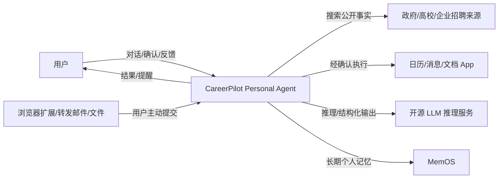
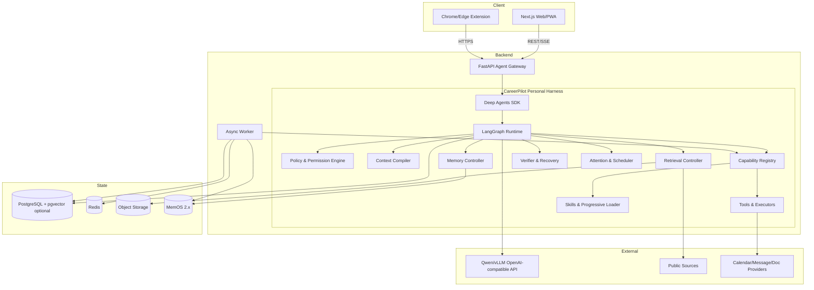
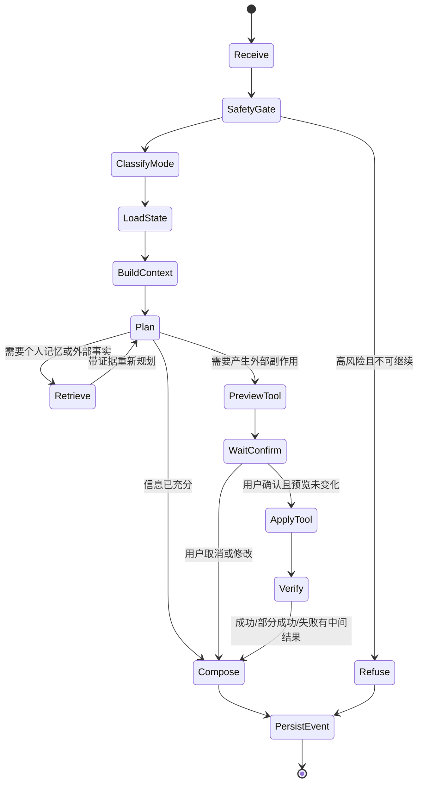
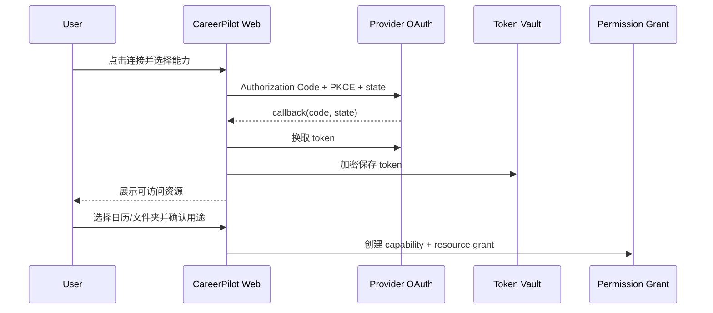

# CareerPilot Personal Harness、Memory、Dreaming 与 Agentic RAG 技术设计

> 文档版本：v0.3  
> 文档状态：技术方案评审稿  
> 上游需求：[CareerPilot MVP PRD](./CareerPilot-MVP-PRD.md)  
> 面向对象：AI 工程、后端、数据、安全、测试

---

## 0. 文档边界

本文只回答“产品需求如何实现”，不重复定义用户、场景、交互和产品规则。以下内容以主 PRD 为唯一产品依据：意图优先级、槽位、确认点、自主性等级、工具触发条件、页面状态、结果定义、埋点和产品指标。

本文负责：

- 如何以 Deep Agents 为通用基座、LangGraph 为持久运行时，实现 CareerPilot Personal Harness；
- 如何在 Harness 中统一管理 Tool、Skill、权限、主动唤醒、验收和轨迹评估；
- 如何以 MemOS 搭建用户级长期记忆；
- 如何将碎片事件组织为 Evidence、Hypothesis 与 Direction；
- 如何将 Dreaming 实现为 Memory System 内部的 Consolidation、遗忘与可回滚 Memory Patch；
- 如何实现 Memory/RAG 路由与迭代检索；
- 如何实现 Personal Action Fabric、连接器注册、授权、回执与回滚；
- 数据结构、接口、异步任务、一致性、安全和可观测性；
- 模型、部署和技术评估方案。

本文不负责：

- UI 文案和交互取舍；
- 产品意图、权限和边界的重新定义；
- 自动投递、外部账号代理、支付；
- 临床心理诊断与治疗系统。

---

## 1. 技术目标与约束

### 1.1 技术目标

1. 对话跨会话后仍可恢复用户目标、关键经历、待验证猜想和未完成行动；
2. 记忆写入、使用和修改均可追溯、可纠正、可删除；
3. 外部事实与个人记忆物理/逻辑隔离，避免网页污染用户画像；
4. Memory Consolidation（Dreaming）能增量发现重复、矛盾和变化，但不能越权改写用户；
5. Agentic RAG 对时效信息提供来源、日期、充分性判断和诚实停止；
6. 任一模块故障时可降级，不伪造“记得”“搜索到”或“已完成”。

### 1.2 MVP 非功能指标

| 指标 | 目标 |
|---|---:|
| Memory Search P95 | ≤800ms（不含主模型生成） |
| 单次写入 P95 | ≤500ms |
| 无工具回复首 Token P95 | ≤2.5s |
| 普通对话完整回复 P95 | ≤8s |
| 外部工具执行 P95 | ≤10s（不含提供方异步完成时间） |
| Agent Run 可用性 | ≥99.5%（月度，第三方故障单列） |
| Memory Consolidation 单用户运行 | ≤60s，异步 |
| 删除传播 SLA | 24h 内主存储、索引、缓存完成 |
| 跨用户数据泄漏 | 0 |
| 未经证据写入 confirmed hypothesis | 0 |
| RAG 事实引用支持率 | ≥95% |
| 搜索无结果幻觉率 | 0 |

### 1.3 技术约束

- 唯一记忆基础设施为 MemOS，不并行引入 Mem0、Letta 或第二套用户向量记忆；
- 确定性任务、权限、审计和状态保存在 PostgreSQL，不依赖向量库恢复；
- MVP 为单前台 Agent + 单 Memory Consolidation Worker；
- 开源主模型通过 OpenAI-compatible 接口接入，业务层不绑定具体推理服务；
- 所有异步写入使用幂等键，所有 Memory Patch 使用版本号和乐观锁。

### 1.4 MVP 容量假设与运行预算

首轮封闭测试按 100 名用户估算：每人每天 20 条 Source Event、5 次 Agent Run、2 次外部事实检索。即约 2,000 条事件/日、500 次 Run/日；设计峰值按 5 RPS、20 个并发 Run 留余量。原始网页、文件和邮件按 0.5MB/用户/日估算，100 用户约 1.5GB/月，需设置来源保留期而不能无限累积。

每次前台 Run 的硬预算：最多 3 次主模型调用、5 次工具调用、3 轮 RAG、12 次状态迁移、60 秒墙钟时间。触顶后必须返回 `partial` 及已获得结果，不允许继续无界自主循环。以上是假设值，封测两周后用真实埋点修订。

---

## 2. 总体架构

### 2.1 Agent Shape 决策

| 维度 | 决策 | 原因 |
|---|---|---|
| Turn | Multi-turn | 职业探索跨会话、跨行动持续数周 |
| Agent Count | Single Agent | 同一个个人身份、目标和上下文；MVP 工具数远低于需要多 Agent 的阈值 |
| Harness | Deep Agents SDK + CareerPilot middleware | 复用通用 Agent loop、Skill、Tool、HITL 与后端接口，领域权限和记忆规则由 CareerPilot 接管 |
| Runtime | LangGraph | 负责状态、checkpoint、streaming、interrupt/resume，不作为长期记忆真相源 |
| Background | Deterministic workers | 记忆巩固、删除传播、监测任务可异步执行，不需要独立人格 |
| Human Gate | Required on external writes | 日历写入、消息发送、删除等副作用必须等待确认 |
| Eval | Trajectory + component eval | 不能只评最终回复，还要评工具选择、顺序、确认点和结果核验 |

最终形态：**一个多轮 Personal Agent + 一个领域 Personal Harness + 多个确定性 Worker + 可插拔 Capability**。Tool 与 Skill 是 Harness 管理的两类能力：Tool 提供外部行动契约，Skill 提供可按需加载的程序性知识。不采用多个“求职 Agent、情绪 Agent、记忆 Agent”互相对话，避免身份分裂、上下文复制和责任不清。

### 2.2 C4 L1：系统上下文



### 2.3 C4 L2：容器与职责



职责边界：

- Deep Agents：通用 Agent Harness 基座，提供 Agent loop、middleware、Skill/Tool 接入、上下文卸载和 Human-in-the-loop 扩展点；
- LangGraph checkpoint：一次 thread/run 的短期执行状态、暂停点和恢复点；
- PostgreSQL：目标、任务、猜想、证据关系、权限、外部资源映射、审计，是确定性状态源；
- MemOS：跨 thread 的个人长期记忆检索，不承担任务状态和权限判断；
- Object Storage：网页/文件/邮件原文等可撤回 Source Event；
- Redis：队列、短锁、限流和流式状态；小规模 MVP 可先用 PostgreSQL job table 替代。

### 2.4 推荐技术栈

| 层 | MVP 选择 | 说明 |
|---|---|---|
| API | FastAPI | 异步接口与 Python AI 生态 |
| Agent Harness | Deep Agents SDK + CareerPilot middleware | 复用通用 Harness；领域记忆、权限、唤醒与验收不使用默认策略 |
| Agent 编排 | LangGraph | 显式状态图、checkpoint、interrupt/resume；只作运行时，不作用户长期记忆 |
| 主模型 | Qwen3.8-27B 目标档 | 中文、结构化输出、工具调用；上线前基准评测 |
| 推理 | vLLM / OpenAI-compatible | 保持模型可替换 |
| Memory | MemOS 2.x | `SingleCubeView` + GeneralTextMemory 起步；用户级 CareerMemCube |
| Embedding | BAAI/bge-m3 候选 | 以中文召回评测与 MemOS 兼容为准 |
| 关系/审计 | PostgreSQL | 事实来源、版本、任务和权限 |
| 异步任务 | Arq（MVP）/ Celery（规模化） | MVP 保持轻量；复杂重试与调度增长后再迁移 |
| 缓存/锁 | Redis | 队列、短期缓存、分布式锁 |
| 观测 | OpenTelemetry + Prometheus | trace、metric、log 关联 |

### 2.5 服务降级

| 故障 | 降级行为 |
|---|---|
| MemOS 不可用 | 使用当前会话回答；明确提示历史个性化暂不可用；停止长期写入 |
| Embedding 不可用 | 允许按 ID/时间读取；停止语义召回，不用关键词结果冒充完整记忆 |
| Memory Consolidation 队列积压 | 延迟记忆巩固与每日回顾生成；前台对话不阻塞；展示最近成功时间 |
| 搜索源不可用 | 换同级来源；达到轮次上限后返回 partial |
| 主模型结构化输出失败 | 一次 repair；再失败使用确定性模板，不执行副作用 |
| PostgreSQL 不可用 | 停止所有写入和工具执行；只允许无状态说明性回复 |

### 2.6 Agent Runtime 状态机



最小运行状态不是聊天记录，而是一份可恢复、可检查的数据结构：

```python
class AgentRunState(TypedDict):
    run_id: str
    thread_id: str
    user_id: str
    intent: str
    support_mode: Literal["listen", "clarify", "act"]
    goal_id: str | None
    plan: list[PlanStep]
    retrieved_refs: list[EvidenceRef]
    pending_action: ActionPreview | None
    permission_grant_id: str | None
    result_status: Literal["running", "waiting_user", "complete", "partial", "failed"]
    model_calls: int
    tool_calls: int
    transition_count: int
```

LLM 只提出下一步；状态迁移、预算、权限和工具参数由代码校验。`interrupt` 只发生在明确的用户确认点，恢复时必须读取同一 checkpoint，并重新校验授权和预览哈希。

### 2.7 模型网关与结构化输出

- 业务只调用 OpenAI-compatible Model Gateway；开发与首版目标模型为 Qwen3.8-27B，部署通过 vLLM，最终型号由中文对话、共情、抽取、规划和工具调用基准共同决定；
- 首版使用一个主模型完成对话与规划，Memory Consolidation 在异步队列复用同一模型；不因“更像 Agent”而提前增加多模型路由；
- 工具调用采用 Qwen 官方支持的 Hermes 风格模板，响应先做 JSON Schema 校验；参数不可修复时只追问，不猜测后执行；
- Prompt 中只注入当前状态、必要记忆摘要、引用和当前可用工具，禁止塞入完整历史、全部记忆或全部工具；
- LangGraph checkpoint 使用 PostgreSQL 持久化。LangGraph Store 不再保存另一份长期用户记忆，避免与 MemOS 形成双真相源。

### 2.8 代码仓库建议

```text
CareerPilot/
├─ apps/
│  ├─ web/                 # Next.js Web/PWA
│  ├─ api/                 # FastAPI Agent Gateway
│  ├─ worker/              # 记忆巩固、删除、监测与补偿任务
│  └─ browser-extension/   # 用户主动采集网页（MVP 后半段）
├─ packages/
│  ├─ contracts/           # Pydantic/JSON Schema、事件与工具契约
│  ├─ personal-harness/    # Deep Agents 之上的领域 Harness
│  │  ├─ runtime/             # LangGraph、checkpoint、interrupt/resume
│  │  ├─ context/             # Context Compiler、compaction
│  │  ├─ memory/              # MemOS Adapter、consolidation、forgetting、governance
│  │  ├─ capabilities/
│  │  │  ├─ tools/               # 行动契约与 executor
│  │  │  └─ skills/              # 渐进式加载的程序性知识
│  │  ├─ policy/              # 风险、权限、确认与隐私
│  │  ├─ proactive/           # Attention Gate 与 Scheduler
│  │  └─ verification/        # 回执、验收、回滚与恢复
│  ├─ connectors/          # Calendar/Message/Document providers
│  └─ evals/               # Golden set、轨迹评估、故障注入
├─ migrations/             # PostgreSQL schema
├─ infra/                  # Docker Compose、部署与观测配置
└─ PRD/
```

MVP 采用模块化单体：API、Worker 可以分进程，但共享 contracts 和同一领域模型。只有某模块出现独立扩缩容或合规边界后才拆微服务。

### 2.9 关键架构决策（ADR）

| ADR | MVP 决策 | 复审触发条件 |
|---|---|---|
| ADR-001 | 单 Personal Agent + 状态图 | 工具超过 25 个且分组后仍显著选错，或领域完全独立 |
| ADR-002 | Deep Agents 作通用 Harness 基座，通过 middleware 扩展而非大幅 Fork | 扩展点无法支持领域权限、记忆或验收契约 |
| ADR-003 | LangGraph 只管理 Run 状态 | 需要替换编排器或 checkpoint 性能不达标 |
| ADR-004 | MemOS 是唯一长期语义记忆；PG 是业务真相源 | MemOS 隔离、删除或召回评估不达标 |
| ADR-005 | 模块化单体，不先拆微服务 | 某模块必须独立扩缩容/合规隔离 |
| ADR-006 | 领域事件 + Outbox 驱动异步工作 | 任务量超过 PG job/Arq 能力或需要复杂工作流编排 |
| ADR-007 | 所有写工具 Preview → Confirm → Apply → Verify | 只读、可逆、用户已授予窄范围持续权限的低风险动作 |

---

## 3. MemOS 集成设计

### 3.1 集成边界

采用“一用户一 CareerMemCube”的逻辑隔离。MVP 按 MemOS 2.x View 架构接入：每次运行创建/获取用户的 `SingleCubeView`，显式传入 `writable_cube_ids` 与 `readable_cube_ids`；不使用已弃用的旧式直接 runtime 调用。若物理上一用户一实例成本过高，则通过 `tenant_id + user_id + mem_cube_id` 强制命名空间隔离。

首版只启用 `GeneralTextMemory`。Evidence—Hypothesis—Direction 关系先由 PostgreSQL 确定性维护，不在 MVP 同时引入 Tree/Graph Memory 与 Neo4j；只有离线评估证明文本召回无法支持关键场景，才增加第二种 MemOS memory type。

MemOS 负责：

- 文本记忆持久化；
- GeneralTextMemory 的索引与检索；
- Add/Search/Feedback 基础接口；
- MemScheduler 或等价调度能力。

CareerPilot 领域层负责：

- 记忆分类、敏感度、TTL 和写入资格；
- candidate/confirmed/rejected/expired 状态；
- Evidence—Hypothesis—Direction 关系；
- 检索计划、用途日志和召回后过滤；
- Memory Patch、用户审批、版本和回滚；
- 删除传播和产品埋点。

### 3.2 适配层接口

```python
class MemoryStore(Protocol):
    async def add(self, record: MemoryRecord, idempotency_key: str) -> str: ...
    async def search(self, query: MemoryQuery) -> list[MemoryHit]: ...
    async def get(self, memory_id: str, user_id: str) -> MemoryRecord: ...
    async def update(self, patch: MemoryPatch, expected_version: int) -> MemoryRecord: ...
    async def feedback(self, memory_id: str, signal: FeedbackSignal) -> None: ...
    async def delete(self, memory_id: str, user_id: str) -> DeleteReceipt: ...
```

业务代码只依赖 `MemoryStore`，MemOS 版本升级封装在 `MemOSAdapter`。禁止在 Agent Prompt 或页面层直接调用 MemOS SDK。

`MemOSAdapter` 内部负责 View 生命周期、cube 路由和字段映射，但不决定“什么值得记”。写入资格仍由 `CareerMemoryPolicy` 决定；MemOS 返回内容也必须经过 user/tenant、状态、TTL、敏感度和用途过滤后才能进入 Context Builder。

### 3.3 命名空间与访问控制

每次操作强制带：

```json
{
  "tenant_id": "careerpilot",
  "user_id": "uuid",
  "mem_cube_id": "career:{user_id}",
  "requester": "foreground_agent|dreaming_worker|user_api",
  "purpose": "respond|reflect|user_control|delete"
}
```

服务端从登录上下文生成 `user_id`，不接受模型或前端自由传入其他用户 ID。数据库行级策略和适配层各校验一次。

---

## 4. 记忆与认知图谱数据模型

### 4.1 分层模型

```text
Event：原始对话、现实经历或工具结果
  ↓ 提取
Memory Record：原子事实/经历/偏好/支持方式
  ↓ 关联
Evidence：支持或反驳某一猜想
  ↓ 累积
Hypothesis：可驳回、带证据和置信区间的理解
  ↓ 组合
Direction：候选职业方向、约束、矛盾和未知
  ↓ 验证
Action Result：现实行动反馈，再转为 Evidence
```

Event 保留“发生了什么”，Memory Record 保留可复用信息，图关系保留“它支持/反驳什么”。不将大段对话摘要直接当作稳定用户画像。

六类 Memory 的职责不同：`profile` 保存稳定背景与约束；`relationship` 保存称呼、共同经历和互动连续性；`episode` 保存重要经历与行动反馈；`boundary_support` 保存用户明确的禁区和被确认有效的支持方式；`goal` 保存长期目标及经授权的跟进承诺；`safety` 只保存经授权且对后续保护必要的最小信息。Safety Policy 本身不进入 Memory。

### 4.2 Memory Record

```json
{
  "memory_id": "uuid",
  "user_id": "uuid",
  "type": "profile|relationship|episode|boundary_support|goal|safety",
  "content": "string",
  "status": "candidate|confirmed|rejected|expired|deleting",
  "confidence": 0.0,
  "source_event_ids": ["uuid"],
  "sensitivity": "normal|sensitive|restricted",
  "valid_from": "datetime",
  "expires_at": "datetime|null",
  "last_confirmed_at": "datetime|null",
  "created_by": "user|foreground_agent|dreaming_worker",
  "embedding_version": "string",
  "policy_version": "string",
  "version": 1,
  "created_at": "datetime",
  "updated_at": "datetime"
}
```

### 4.3 Hypothesis

```json
{
  "hypothesis_id": "uuid",
  "user_id": "uuid",
  "statement": "用户可能更在意可预期的工作节奏，而非编制本身",
  "status": "candidate|confirmed|rejected|superseded",
  "confidence_band": "low|medium|high",
  "supporting_evidence_ids": ["uuid"],
  "contradicting_evidence_ids": ["uuid"],
  "open_questions": ["string"],
  "user_feedback": "agree|partly_agree|reject|unknown",
  "version": 3
}
```

置信度计算只作为排序信号，不直接向用户展示伪精确数值。`high` 至少要求两个独立来源的支持证据且不存在未处理的强反证。

### 4.4 Evidence Link

```json
{
  "evidence_id": "uuid",
  "source_type": "memory|event|action_result",
  "source_id": "uuid",
  "target_type": "hypothesis|direction",
  "target_id": "uuid",
  "relation": "supports|contradicts|context",
  "strength": "weak|medium|strong",
  "created_by": "user|agent|dreaming_worker"
}
```

### 4.5 Direction

```json
{
  "direction_id": "uuid",
  "name": "国央企产品/数字化岗位",
  "stage": "noticed|exploring|validating|paused|rejected",
  "hypothesis_ids": ["uuid"],
  "constraint_snapshot": {},
  "unknowns": ["实际工作节奏", "地点接受度"],
  "next_validation_action_id": "uuid|null",
  "version": 2
}
```

### 4.6 PostgreSQL 表

- `memory_records`：MemOS ID、业务元数据、版本和删除状态；
- `source_events`：事件元数据和撤回状态；
- `hypotheses`：猜想及用户反馈；
- `evidence_links`：支持/反驳关系；
- `directions` / `direction_versions`：候选方向与版本；
- `memory_use_logs`：检索原因、候选、实际使用和结果；
- `memory_patches`：Dreaming Patch 与审批；
- `dreaming_runs`：输入窗口、模型版本、状态和成本；
- `retrieval_runs` / `retrieval_sources`：外部检索轨迹；
- `delete_jobs`：删除传播进度和错误；
- `consent_logs`：记忆授权与撤销。

---

## 5. 记忆写入管线

### 5.1 前台写入流程

```text
用户消息/工具结果
→ 创建Source Event
→ 分类器提取候选原子信息
→ CareerMemoryPolicy校验
→ 去重与冲突检测
→ sensitivity/TTL/status赋值
→ 写PostgreSQL元数据
→ MemOS Add
→ 写索引版本和审计
→ 返回candidate memory id
```

### 5.2 写入资格

| 内容 | 是否进入长期记忆 | 默认状态/TTL |
|---|---|---|
| 用户明确稳定事实/约束 | 是 | candidate profile；必要时确认 |
| 称呼、共同经历和互动约定 | 是 | relationship；高稳定性，变更需证据 |
| 一次短期情绪 | 仅 Working Context/短期 episode | TTL 7—14 天 |
| 重复出现的偏好 | 是，先累计证据 | candidate profile 或 boundary_support |
| 职业方向判断 | 不写普通事实 | goal 或 hypothesis candidate |
| 有效/不喜欢的安抚方式 | 用户明确反馈后 | confirmed boundary_support |
| 行动结果 | 是 | episode，并可形成 Evidence |
| 通用情绪支持方法 | 否 | 进入 `companion_support` RAG 或 Skill，不进入 Memory |
| 当前岗位/日历/报名状态 | 否 | Tool/API 本次读取，必要时存 Product State |
| 模型自行推断 | 仅有来源时可成 hypothesis | 禁止 confirmed |
| 健康/家庭冲突细节 | 默认否 | restricted，需显式授权 |

### 5.3 CareerMemoryPolicy

策略输入：候选内容、来源事件、当前授权、敏感度、重复结果、冲突结果、任务目的、用户反馈。

策略输出：

```json
{
  "decision": "store|event_only|ask_confirmation|reject",
  "type": "boundary_support",
  "status": "candidate",
  "sensitivity": "normal",
  "ttl_days": null,
  "reason_codes": ["repeated_signal", "goal_relevant"],
  "requires_user_confirmation": false
}
```

LLM 可提出分类建议，最终决策由确定性政策和 schema validator 执行。

### 5.4 去重与冲突

- 候选召回同类型 Top-10，再由结构化比较器判断 `duplicate/extends/conflicts/unrelated`；
- duplicate：增加来源，不覆盖原文；
- extends：创建新版本或补充 Evidence；
- conflicts：两条均保留，建立 contradicts 关系并进入待复核；
- 用户当前明确陈述优先影响当次响应，但不静默删除旧版本。

### 5.5 幂等与一致性

幂等键：`user_id + source_event_id + extractor_version + content_hash`。PostgreSQL 先写 pending，再调用 MemOS，成功后改 committed；失败进入补偿队列。读路径只召回 committed 记录。

---

## 6. 记忆检索管线

### 6.1 检索计划

Agent 不直接用用户原话做全库 Top-K。Memory Controller 接收结构化计划：

```json
{
  "purpose": "compare_career_directions",
  "types": ["profile", "episode", "boundary_support", "goal"],
  "query": "稳定性、工作节奏、国央企体验",
  "time_range": null,
  "status_allowlist": ["confirmed", "candidate"],
  "sensitivity_ceiling": "normal",
  "limit": 5
}
```

### 6.2 召回与重排

```text
MemOS语义/图检索
→ user_id/status/sensitivity/expiry硬过滤
→ 目标相关性重排
→ 冲突与反证补召回
→ 多样性去重
→ 限制最多5条
→ 生成Memory Context与Use Log
```

建议评分：

```text
score = semantic_relevance
      + goal_relevance
      + confirmation_weight
      + evidence_quality
      + recency_if_needed
      - rejection_penalty
      - expiry_penalty
      - sensitivity_penalty
```

### 6.3 反证检索

当召回某个 hypothesis 时，必须通过关系表补取至少一条反证或确认“当前无反证”。禁止只检索支持当前结论的记忆。

### 6.4 使用日志

```json
{
  "memory_use_log_id": "uuid",
  "agent_run_id": "uuid",
  "purpose": "string",
  "candidate_memory_ids": ["uuid"],
  "selected_memory_ids": ["uuid"],
  "selection_reason_codes": ["goal_relevant", "confirmed"],
  "influence": "constrain_action|support_hypothesis|personalize_tone",
  "user_corrected": false,
  "outcome_signal": null
}
```

### 6.5 缓存

- 仅缓存普通敏感度的查询结果；
- key 必须包含 user_id、query_hash、policy_version 和 memory_version；
- 用户编辑/删除/驳回后递增 memory_version，使旧缓存立即失效；
- restricted 内容不进入共享缓存和分析日志。

---

## 7. Memory Consolidation（Dreaming）实现

Dreaming 是 Memory System 内部的周期性巩固阶段，不是独立产品模块，也不等于每日总结。参考 Claude 的长程 Agent 设计，系统将“可恢复的完整经历”与“本轮模型看到的精简上下文”分离：Source Event 作为 append-only Session Log 保留，Consolidation 仅生成可版本化的结构化记忆，Context Compiler 再按当前任务选择高信号内容。

### 7.1 调度

触发器：用户当地时间每日一次；自上次成功运行新增 20 个有效事件；重要行动完成；用户手动复盘。每日触发的同一运行可顺带刷新 Daily Review Read Model，但该视图不参与 Memory Patch 是否提交的决策。相同用户同一时间只允许一个运行实例。

幂等键：`user_id + event_window_end + consolidation_policy_version`。

### 7.2 Pipeline

```text
确定增量Event Window
→ 加载事件、相关Memory、Hypothesis和反证
→ 事件去重与时间排序
→ 识别重复模式、矛盾、变化、未闭环行动
→ 生成结构化Patch草稿
→ Schema/来源/敏感/权限规则校验
→ 确定性Diff与影响分析
→ 自动应用低风险Patch
→ 高影响Patch进入用户审批队列
→ 基于当日事件与已提交记忆生成 Daily Review Read Model
→ 写运行日志与指标
```

### 7.3 Memory Patch

```json
{
  "patch_id": "uuid",
  "user_id": "uuid",
  "target_type": "memory|hypothesis|direction",
  "target_id": "uuid|null",
  "operation": "add|merge|promote|demote|expire|link",
  "before": {},
  "after": {},
  "supporting_event_ids": ["uuid"],
  "contradicting_event_ids": ["uuid"],
  "reason_codes": ["repeated_pattern", "new_action_result"],
  "requires_confirmation": true,
  "expected_version": 2,
  "rollback_patch": {},
  "policy_version": "memory-consolidation-v1"
}
```

### 7.4 自动应用白名单

可自动应用：合并完全重复事件、更新最后使用时间、给一次事件设置 TTL、关联明确的 task_id/action_result、过期已到期短期状态。

必须用户确认：新增或提高职业偏好、改变候选方向、把 candidate 提升为 confirmed、保存敏感信息、删除非重复记忆、基于矛盾证据选择一个版本。

### 7.5 并发与回滚

Patch 应用采用 `expected_version` 乐观锁。版本冲突时重新加载并生成新 Diff，不允许强制覆盖。每个已应用 Patch 保留逆向 Patch；用户撤销时写新版本，不篡改历史审计。

### 7.6 Consolidation 输出校验

- 每个变更至少有一个 source_event_id；
- 高影响变更必须主动检查反证；
- 不生成疾病、人格障碍或道德标签；
- 不以情绪强度直接推高长期权重；
- 不处理已撤回或正在删除的事件；
- Daily Review Read Model 与 Patch 分离：用户看到、编辑或保存每日回顾不代表高影响 Patch 已应用。

### 7.7 每日回顾视图

每日回顾不建立独立业务目录或独立记忆类型。它是从当日 Source Event、Action Result 和已提交 Memory 生成的可重建 Read Model，包含：重要经历、新想法、已完成行动、一个明日可选步骤。用户编辑后只新增一条 `daily_review_edited` Source Event，不直接覆盖底层记忆；后续 Consolidation 可将其作为高信号用户反馈。

---

## 8. Agentic RAG 实现

> MVP 的 Skill 选型、统一 Markdown 交付契约、开发者上传入口、切分与索引初值，见
> `PRD/CareerPilot-RAG-MVP-Design.md`。本章保留完整演进架构，MVP 文档负责当前建设范围。

### 8.1 Context Router：先定责任，再做检索

Context Router 必须在 Memory Search 或 RAG Retrieval 之前完成分类。不能以“内容相似”代替系统边界：

| 路由问题 | 目标系统 | 存储/运行时 | 示例 |
|---|---|---|---|
| 是否只对当前对话成立？ | Working Context | LangGraph checkpoint + TTL | 此刻情绪、本轮“只听我说”、未确认细节 |
| 是否描述这个用户的跨时间事实或关系？ | Personal Memory | MemOS + PG 元数据 | 称呼、经历、目标、支持偏好、关系边界 |
| 是否是对多人可复用的方法或外部资料？ | Governed RAG | Object Storage + PG + pgvector | 倾听方法、职业路径、技术文档、JD 分析方法 |
| 是否是不可选的行为/安全/权限规则？ | Policy / Skill | 版本控制文件 + Policy Engine | 先慰藉、安全分流、Preview/Confirm/Apply |
| 是否是实时变化或需要执行的外部状态？ | Tool / API | Connector 本次调用 + Receipt | 岗位在招、截止日期、日历空闲、创建提醒 |
| 是否是确定性业务状态？ | Product State | PostgreSQL | 任务、收藏、研究进度、权限、审计 |

同一主题可因来源不同走不同路径。例如公司制度由用户亲身经历描述时可形成 Episode Memory；来自公司制度文件时进入 RAG；来自实时组织系统时通过 Tool/API 获取。Router 输出 `context_class + purpose + freshness_requirement + allowed_storage`，后续模块不得自行跨类写入。

### 8.1.1 物理与逻辑隔离

| 数据 | 存储 | 主键/隔离 | 进入模型的方式 |
|---|---|---|---|
| 当前消息、短期情绪和未确认细节 | LangGraph checkpoint | `thread_id + run_id`，短期 TTL | Working Context，按当前 run 装配 |
| 用户长期记忆 | MemOS + PostgreSQL 元数据 | 强制 `tenant_id + user_id` | Memory Controller 按用途召回并记录 use log |
| RAG 原文、版本、切片、Embedding、来源证据 | Object Storage + PostgreSQL + pgvector/可替换索引 | `knowledge_item_id + version_id`，跨用户共享 | Retrieval Controller 按知识缺口召回并附引用 |
| 用户收藏、阅读、相关性反馈、方向/猜想关联 | PostgreSQL Product State | `user_id + knowledge_item_id + relation_type` | 只在相关页面或当前目标需要时装配 |
| 强制行为与安全边界 | Policy/Skill Registry | `policy_id/skill_id + version` | 始终或按场景加载，优先级高于模型输出 |
| 实时数据与外部行动 | Tool/API + receipt log | `tool_call_id + idempotency_key` | 本次调用结果；副作用需 Verify |

“研究视图”不是第三套知识或第二套 Memory，而是 Product State 对 RAG 引用关系的投影。任何网页、论文、支持方法或 JD 正文不得写入 MemOS；收藏、阅读和点击也不得直接推断偏好。只有用户随后明确表达或现实反馈形成稳定个人事实，并通过 `CareerMemoryPolicy`，才可建立独立 Memory 候选。

### 8.1.2 Governed RAG 知识域

RAG 一级域覆盖陪伴方法与职业知识，而不只覆盖求职资料：

| 一级域 | 子域 | 内容 | 典型实体/元数据 |
|---|---|---|---|
| `companion_support` | `listening` / `stress_review` / `communication` / `cognitive_reframing` / `sleep_relaxation` / `safety_reference` | 经审核的情绪接住方法、复盘方法、练习与现实求助资源说明 | 适用状态、禁忌、证据等级、审核版本、地区、有效期 |
| `career_knowledge` | `career_world` | 公务员、选调、事业单位、国央企、民企、外企等路径及进入机制 | 组织类型、进入途径、用工关系、地区、政策版本 |
| `career_knowledge` | `domain_knowledge` | 进入专业领域所需概念、方法、工具、官方文档和论文 | `agent_system`、`rag`、`memory`、`harness`、`mcp`、技术版本 |
| `career_knowledge` | `role_market` | 产品、Agent 产品、算法、工程等岗位职责、能力模型、JD 和面试知识 | 岗位族、技能、资历、公司、地点、发布日期 |

`knowledge_domains` 与 `knowledge_subdomains` 均可多选。同一份 Agent 产品经理 JD 可同时命中 `domain_knowledge:agent_system` 与 `role_market:ai_product_manager`。领域标签只用于检索规划、过滤和评估，不能替代来源证据。

`companion_support` 只提供候选方法和解释：是否先慰藉、何时停止行动建议、危机如何分流、禁止哪些工具由 Policy/Skill 决定，不能把强制安全责任交给一次可能 miss 的向量检索。

### 8.1.3 Context Compiler 装配顺序

```text
Policy/Skill（强制）
+ Working Context（本轮）
+ Personal Memory（关于这个用户，按 purpose 召回）
+ RAG（通用方法/外部知识，带引用）
+ Tool/API Result（实时状态，带 fetched_at/receipt）
+ Product State（任务/研究/权限）
→ LLM Compose → Response Validator / Tool Gate
```

Memory 命中不能证明公共事实正确；RAG 命中不能证明用户偏好；Tool Result 不得未经 Memory Policy 自动沉淀为人格结论。

### 8.1.4 Agentic 自动摄取

自动摄取由真实知识缺口触发，不运行无目标的全网爬取：

```text
KnowledgeGap(user goal + missing knowledge + freshness requirement)
→ 先检索 Governed RAG
→ Sufficiency Checker 判断缺失/过期/冲突
→ Web/Search Connector 发现候选来源
→ Candidate Quarantine
→ Fetch 原文与 canonical URL
→ 来源等级、正文完整性、相关性、时效、恶意指令检查
→ 内容 hash/实体/语义去重与版本判断
→ 结构化抽取 + 领域感知切分 + Embedding
→ 本次 Run 先保留 Tool Evidence
→ 具有复用价值的文档 Publish active version
→ 建立 Research State Link（Product State）
```

候选资料只有同时满足以下条件才进入活跃知识库：原始来源可打开；正文可提取；与 `knowledge_gap` 相关；有发布日期/版本或可解释其缺失；通过提示注入与恶意内容检查；不是已有版本的无变化副本；切片保留父文档、标题层级和 source span。搜索结果摘要、模型生成总结、无法回源的转载不得作为主知识条目。

并发用户发现相同 URL 或内容 hash 时，只创建一个公共摄取任务；其他 Run 等待或复用结果。发布采用 `candidate → validated → active` 状态机，失败保留错误码而不进入召回。模型可以提出标签和结构化字段，但 URL、hash、时间、状态迁移和发布条件由确定性代码验证。

### 8.1.5 生命周期与刷新

| 内容类型 | 初始刷新策略 | 失效行为 |
|---|---|---|
| 在招岗位、宣讲会、报名公告 | 按截止时间；无截止时间时 24—72 小时复查 | 截止或来源撤下后退出活跃机会召回，历史引用保留 |
| 政策、考试规则、组织名录 | 30 天复查或检测官方版本变化 | 旧版本标记 superseded，回答必须使用适用时间范围 |
| 岗位市场/JD 聚合结论 | 7—30 天按样本更新 | 样本不足时降级为观察，不输出确定趋势 |
| 官方技术文档/框架说明 | 30—90 天或版本发布触发 | 新旧版本并存并记录适用版本 |
| 论文与基础概念 | 原文长期保存；勘误/新版本触发更新 | 不因“时间较久”自动失效，但回答需区分研究结论与当前产品事实 |
| 情绪支持方法与练习 | 90 天复审或证据/安全指南更新时触发 | 旧版本停止推荐但保留审计；高风险场景始终由 Policy 分流 |

请求到达时采用 stale-while-revalidate：可安全使用且未超过硬过期的资料可以先回答并标注验证时间，同时异步刷新；硬过期、截止时间类或发生来源冲突的资料不得继续作为当前事实。用户点击“要求刷新”、来源返回 ETag/Last-Modified 变化、引用失败或高频召回均可触发刷新任务。

### 8.1.6 最小数据表

- `knowledge_items`：canonical URL、标题、知识域、来源等级、当前 active version、状态；
- `knowledge_versions`：正文对象地址、content hash、发布时间、抓取时间、有效期、解析器版本；
- `knowledge_chunks`：父版本、标题路径、source span、chunk hash、embedding version；
- `knowledge_gaps`：用户目标、缺失知识、时效要求、状态和完成标准；
- `ingestion_jobs`：候选 URL、状态、质量检查结果、幂等键、失败码；
- `user_research_links`：Product State；用户、知识条目、关联目标/方向/猜想、读过/收藏/无关/要求刷新状态；
- `knowledge_citations`：Agent Run、chunk、支持的输出字段和引用位置。

公共表不存 `user_id`；研究关系表不复制正文，也不进入 MemOS。删除一个用户的研究关系不会删除公共资料或其他用户的关系；公共资料因版权、安全或来源撤回被删除时，所有用户关系保留最小不可反推内容的失效占位。

### 8.2 检索 Run Schema

```json
{
  "retrieval_run_id": "uuid",
  "agent_run_id": "uuid",
  "objective": "查找上海本周国央企宣讲会",
  "constraints": {
    "destination_type": ["central_soe", "local_state_controlled_enterprise"],
    "entry_path": ["campus_recruitment"],
    "employment_relation": ["direct_labor_contract", "unknown"],
    "occupation_codes": [],
    "location": ["上海"],
    "date_range": ["...", "..."]
  },
  "queries": [],
  "round": 1,
  "max_rounds": 3,
  "source_tiers": [1, 2],
  "sufficiency": "unknown|enough|insufficient|conflicted",
  "stop_reason": null
}
```

### 8.3 迭代流程

```text
识别外部知识缺口
→ 生成KnowledgeGap并拆解子目标与硬约束
→ 优先检索 Governed RAG；研究关系只用于目标过滤，不作为个性事实
→ 结果充分且有效则直接重排引用
→ 不足、过期或冲突时选择Source Connector和日期范围
→ 生成查询并执行
→ 候选资料进入隔离区，规范化、去重和质量检查
→ 打开原始来源并抽取字段
→ 日期/地点/资格/来源交叉检查
→ Sufficiency Checker判断
→ 不充分时改写查询或换源，最多3轮
→ 本轮保留 Tool Evidence；可复用资料通过质量门后切分、索引并发布；建立 Research State Link
→ 生成Citation-backed Result
```

### 8.4 来源等级与 Connector

| Tier | 来源 | MVP 策略 |
|---|---|---|
| 1 | 企业招聘官网、高校就业中心、政府/事业单位官网 | 优先、可单独支持强事实 |
| 2 | 官方认证招聘平台、企业认证账号 | 可用于补充和交叉验证 |
| 3 | 可追溯聚合站 | 只作线索，尽量回源 |
| 4 | 社区/个人内容 | 只用于经验，不支持截止日期等事实 |

Connector 统一输出：URL、canonical_url、title、source_tier、published_at、fetched_at、content_hash、extracted_fields、fetch_status。

### 8.5 结果规范化

```json
{
  "opportunity_id": "derived-hash",
  "classification_version": "career-taxonomy-1.0",
  "title": "string",
  "organization": "string",
  "opportunity_type": "campus_event|job|internship|policy",
  "classification": {
    "destination_type": "party_government|public_institution|central_soe|local_state_controlled_enterprise|private_enterprise|foreign_invested_enterprise|social_organization|military|self_employed|other|unknown",
    "entry_path": "central_civil_service_exam|local_civil_service_exam|selected_graduate|public_institution_recruitment|campus_recruitment|social_recruitment|intern_conversion|grassroots_service_project|military_recruitment|self_employment|other|unknown",
    "employment_relation": "civil_servant|public_institution_staffed|public_institution_nonstaffed|direct_labor_contract|labor_dispatch|service_outsourcing|non_full_time|project_service|self_employed|unknown",
    "occupation_code": "国家职业分类代码|null",
    "occupation_label": "string|null",
    "product_function_tag": "研发/技术|产品/项目|运营/市场|财务/金融|法律/合规|行政/人力|教育/科研|医疗健康|生产/工程|销售/服务|其他|待分类"
  },
  "classification_evidence": [
    {
      "field": "classification.employment_relation",
      "value": "unknown",
      "source_url": "https://...",
      "source_tier": "1|2|3|4|user_confirmed",
      "evidence_text_hash": "sha256",
      "status": "verified|partially_verified|user_confirm_needed|conflicted"
    }
  ],
  "internal_headcount_note": "招聘公告中的原始内部口径|null",
  "location": ["string"],
  "starts_at": "datetime|null",
  "deadline": "datetime|null",
  "eligibility": ["string"],
  "source_url": "https://...",
  "source_tier": 1,
  "published_at": "datetime|null",
  "fetched_at": "datetime",
  "verification_status": "verified|partially_verified|user_confirm_needed|conflicted"
}
```

### 8.6 四维分类流水线

```text
抽取组织名称与招聘主体
→ 实体消歧，核验组织属性/控制关系
→ 从公告抽取进入途径
→ 从合同主体、用工说明抽取用工关系
→ 将岗位职责映射到国家职业代码与产品职能标签
→ 为每个字段绑定独立 Evidence
→ Schema Validator 与冲突检测
→ 输出已核验、待核验或冲突，不做常识补全
```

实现约束：

- 组织属性优先使用政府/国资委名录、登记或企业官方权属信息；不得用名称中的“国、集团、事业部”推断；
- `central_soe` 只表示组织权属，不得级联写入 `direct_labor_contract`；
- 用工关系只能由公告原文、合同/offer 的用户确认或招聘方确认支持。“正式员工”“正式编制”等内部表述写入 `internal_headcount_note`，不能覆盖标准枚举；
- 职业代码必须来自受版本控制的《职业分类大典》映射表。模型可提出候选，确定值必须通过字典校验；
- 用户纠正产生新的 `classification_evidence`，`source_tier` 标为 `user_confirmed` 并保留旧值版本；原始网页证据不可改写；
- 每次分类保存 `classification_version`，字典升级时异步重算并保留旧版本，避免历史卡片静默变化。

### 8.7 充分性检查

对每个结果检查：标题和主体是否明确、日期是否未过期、地点/资格是否满足硬约束、来源是否可打开、关键字段是否由正文支持、是否与其他权威来源冲突。组织属性、进入途径和用户明确要求的硬约束必须有证据；用工关系未知不等于结果无效，但必须返回 `unknown + user_confirm_needed`，且不得声称满足“直签”筛选。

停止条件：三轮无可信结果；权威来源冲突无法消解；页面失效或日期无法确认；缺少会显著改变结果的用户条件；需要登录/提交；达到时间/Token/来源预算。

### 8.8 引用与防幻觉

- 每个事实字段保存 source span 或 extracted field evidence；
- 最终内容只能引用通过 validator 的字段；
- 搜索摘要不作为最终事实来源，尽量打开原页；
- 外部页面永远是 untrusted content，不能覆盖 System Policy 或生成工具参数；
- 无结果返回 `insufficient`，禁止补全貌似合理的单位、时间和链接。

---

## 9. 服务接口

### 9.1 Memory Search

```http
POST /internal/memory/search
{
  "user_id": "from-auth-context",
  "purpose": "compare_directions",
  "types": ["profile", "episode", "goal"],
  "query": "工作节奏和稳定性",
  "limit": 5,
  "sensitivity_ceiling": "normal"
}
```

响应：

```json
{
  "hits": [{"memory_id": "uuid", "content": "...", "score": 0.81, "reason_codes": []}],
  "conflicts": [],
  "memory_use_log_id": "uuid"
}
```

### 9.2 Memory Propose

```http
POST /internal/memory/proposals
{
  "source_event_id": "uuid",
  "candidate": {"type": "boundary_support", "content": "..."},
  "agent_run_id": "uuid"
}
```

响应包含 `policy_decision`、`proposal_id`、是否需要确认，不直接假设写入成功。

### 9.3 Patch Review

```http
POST /api/memory/patches/{patch_id}/decision
{
  "decision": "accept|edit|reject",
  "edited_after": null,
  "expected_version": 2
}
```

### 9.4 Retrieval Run

```http
POST /internal/retrieval/runs
{
  "agent_run_id": "uuid",
  "objective": "查找上海本周国央企宣讲会",
  "constraints": {},
  "max_rounds": 3,
  "result_limit": 3
}
```

### 9.5 Delete Memory

```http
DELETE /api/memories/{memory_id}
{
  "expected_version": 4
}
```

立即返回 `delete_job_id` 和产品状态 `deleting`。Worker 完成 MemOS、关系、缓存和备份策略允许范围内的传播后更新为 `deleted`。

### 9.6 Action 与 Calendar Connector

内部 `actions` 表是唯一状态源，外部日历是投影，不允许用第三方日程正文反向覆盖 Memory。

```json
{
  "action_id": "uuid",
  "user_id": "from-auth-context",
  "title": "查看本省选调公告并记录三个资格差距",
  "status": "draft|scheduled|waiting_feedback|completed|postponed|cancelled|sync_error",
  "starts_at": "datetime",
  "ends_at": "datetime",
  "completion_criteria": "记录三个资格差距",
  "reminder_policy": {"offset_minutes": 30, "max_pushes": 1},
  "version": 3
}
```

外部资源映射独立保存：

```json
{
  "external_link_id": "uuid",
  "action_id": "uuid",
  "provider": "feishu|ics|google|outlook",
  "external_account_id_hash": "sha256",
  "external_calendar_id_ciphertext": "encrypted|null",
  "external_event_id": "string|null",
  "sync_status": "pending|synced|exported_unverified|conflicted|failed|deleted|disconnected",
  "external_etag": "string|null",
  "last_synced_at": "datetime|null",
  "last_error_code": "string|null",
  "version": 1
}
```

执行契约：

```http
POST /internal/actions/{action_id}/calendar-sync
{
  "provider": "feishu",
  "operation": "create|update|delete",
  "expected_action_version": 3,
  "permission_grant_id": "uuid",
  "idempotency_key": "action_id:provider:operation:version"
}
```

处理链路：校验当前用户与授权快照 → 从白名单字段构造日程 → 调用 Provider Adapter → 校验外部回执 → 事务性写入 `external_event_id` 与审计记录 → 返回 `synced`。网络超时但结果未知时先按幂等键查询或重试，不得直接重复创建。

Feishu Adapter MVP 映射：

- Calendar API：创建日程；只有已绑定 `external_event_id` 时才允许更新或删除；
- IM API：发送低敏交互提醒卡，payload 只含 action_id 对应的短期签名 token；
- Card callback：验签、校验用户和 token 过期时间，再写入完成/延期事件；回调本身不直接生成稳定记忆；
- OAuth Token 使用独立密钥加密，日志只保存 scope 枚举、token 版本和脱敏账户 ID；
- 撤销授权后清除可用 Token、停止提醒任务，并将相关映射标记为 disconnected；历史审计只保留不可反推隐私的最小元数据。

ICS Adapter 只负责生成文件，不返回可持续同步的 `external_event_id`，因此状态显示为 `exported_unverified`，不能宣称日程已加入用户日历。

### 9.7 Personal Action Fabric 与 Capability Registry

业务编排只能依赖标准能力，不能直接依赖飞书、Google、Notion 等 Provider 字段。每个连接器注册能力清单：

```json
{
  "provider_id": "feishu",
  "connector_version": "1.0.0",
  "capabilities": [
    "calendar.read_availability",
    "calendar.create",
    "calendar.update",
    "calendar.delete",
    "notification.send_interactive",
    "notification.receive_callback"
  ],
  "auth_mode": "oauth2",
  "data_residency": "external",
  "risk_levels": {
    "calendar.read_availability": "L1",
    "calendar.create": "L3",
    "notification.send_interactive": "L3"
  }
}
```

统一调用信封：

```json
{
  "tool_call_id": "uuid",
  "agent_run_id": "uuid",
  "user_id": "from-auth-context",
  "capability": "calendar.create",
  "provider_preference": "feishu|auto",
  "purpose": "schedule_exploration_action",
  "payload_ref": "encrypted-object-ref",
  "preview_hash": "sha256(normalized_capability+resource+payload+version)",
  "permission_grant_id": "uuid",
  "confirmation_token": "single-use-token",
  "idempotency_key": "string",
  "timeout_ms": 10000
}
```

写操作分成两个独立端点：`POST /actions/preview` 只校验并返回影响范围、可撤销性与 `preview_hash`；`POST /actions/apply` 必须携带同一哈希、单次确认令牌和幂等键。任一 payload、目标资源、权限或业务版本发生变化，必须重新预览，禁止“确认 A、执行 B”。

标准结果只返回可验证状态：

```json
{
  "tool_call_id": "uuid",
  "status": "completed|partial|failed|unknown",
  "provider_id": "feishu",
  "external_resource_refs": [{"type": "calendar_event", "id_ciphertext": "encrypted"}],
  "observations": [{"type": "receipt", "code": "created"}],
  "retryable": false,
  "rollback_capability": "calendar.delete|null"
}
```

`observations` 先写入 Source Event。只有通过 Memory Policy 且与用户目标相关时，才可能变成 Evidence 或 Memory；第三方原文和工具返回不得直接进入稳定画像。

MVP Connector Pack：

| Connector | 标准能力 | 权限策略 |
|---|---|---|
| Browser Capture | `capture.current_page` | 用户点击后使用 `activeTab` 临时读取当前页；默认无全站权限 |
| Link/File Inbox | `inbox.ingest_url/file` | 用户显式提交；恶意内容扫描；正文可独立删除 |
| Forwarded Email | `inbox.ingest_forwarded_email` | 只处理专属地址收到的主动转发，不连接完整邮箱 |
| Web Research | `research.search/fetch/verify` | 只读公开页面；遵守来源规则与预算 |
| CareerPilot Action | `task.create/update/cancel` | 内部事务与审计；用户可撤销 |
| CareerPilot Artifact | `artifact.create/version/export` | 默认只生成草稿，不向第三方发布 |
| Calendar Provider | `calendar.create/update/delete` | 每次外部写入确认；Provider 可替换 |
| Feedback Channel | `notification.send/receive_callback` | 低敏字段；频率和勿扰限制 |

浏览器扩展与 Web 端通过短期设备授权绑定。采集请求必须携带用户手势证明、页面 origin 和字段预览；服务端重新抓取公开页面时仍按 untrusted content 处理。扩展不得读取密码框、Cookie、跨域会话 Token 或后台浏览历史。

### 9.8 Connector API 与权限矩阵

#### P0

| Connector | 认证/本地权限 | 调用 | 数据范围 | 回调/回执 |
|---|---|---|---|---|
| Chrome/Edge | Manifest V3：`sidePanel`, `activeTab`, `scripting`, `storage`；不配置全站 `host_permissions` | 扩展 `activeTab` 读取当前页 → `POST /api/inbox/web-captures` | 当前用户点击的单页 | 返回 `inbox_item_id`；字段预览确认后保存 |
| 转发邮箱 | 每用户随机 alias；邮件供应商 webhook 验签；无邮箱 OAuth | `POST /webhooks/inbound-email/{alias}` | 仅主动转发的单封邮件 | SPF/DKIM/大小/病毒检查后返回队列 ID |
| 飞书日历 | OAuth `user_access_token`；申请“更新日历及日程信息”，不申请组织通讯录 | `POST/PATCH/DELETE /open-apis/calendar/v4/calendars/{calendar_id}/events[/{event_id}]` | 用户选择的日历；仅操作绑定 `action_id` 的事件 | 保存 `event_id`；失败映射标准错误；更新前比对版本 |
| 飞书机器人 | 应用机器人 + `im:message`；用户必须在应用可用范围 | `POST /open-apis/im/v1/messages?receive_id_type=open_id`，`msg_type=interactive` | 低敏提醒卡 | 卡片回调到 `/webhooks/feishu/card`；验签、一次性 token、5 分钟过期 |
| ICS | 无第三方权限 | `GET /api/actions/{action_id}/calendar.ics` | 单个行动的标题、时间、公开链接 | 只能标记 `exported_unverified` |

飞书 permission code 以创建应用时开放平台控制台返回值为准，CI 中保存允许 scope 白名单；发现新增 scope 时阻断部署，避免文档名称与平台版本变化造成越权。

#### P1

| Provider | OAuth scope | 关键 API | 产品限制 |
|---|---|---|---|
| Google Calendar | `https://www.googleapis.com/auth/calendar.events` | `POST /calendar/v3/calendars/{calendarId}/events`；`PATCH/DELETE .../{eventId}` | 不申请完整 `calendar` scope；只管理带私有 `action_id` 的事件 |
| Gmail | 默认使用用户触发的 Gmail Add-on 当前邮件权限；监测标签才申请 `gmail.readonly` | `GET /gmail/v1/users/me/messages`、`GET .../messages/{id}`、可选 `POST .../watch` | `gmail.readonly` 范围很广且受限制，不能作为默认授权 |
| Microsoft Outlook | delegated `Mail.Read`；日历 `Calendars.ReadWrite` | `GET /v1.0/me/mailFolders/{id}/messages`；`POST /v1.0/me/calendar/events` | 只读取用户选定文件夹；不申请 application permission |
| Notion | OAuth + 用户显式分享页面；content read/insert/update capabilities | `POST /v1/search`、`GET /v1/pages/{id}`、`POST/PATCH /v1/pages` | 仅访问用户分享给 integration 的页面；不搜索整个 workspace |

#### 授权对象

```json
{
  "permission_grant_id": "uuid",
  "user_id": "uuid",
  "provider": "feishu",
  "account_id_hash": "sha256",
  "capabilities": ["calendar.create", "notification.send_interactive"],
  "resource_constraints": {"calendar_ids": ["encrypted-ref"]},
  "purpose": "career_action_management",
  "granted_at": "datetime",
  "expires_at": "datetime|null",
  "revoked_at": null,
  "scope_snapshot": ["provider-scope-code"]
}
```

执行前同时校验 OAuth scope、内部 capability、资源范围、用途、是否逐次确认；任何一项不满足均返回 `permission_required`，模型无权扩大授权。

#### 关联流程



- Chrome/Edge：Web 生成 5 分钟一次性 pairing code；扩展换取设备级短期 token，用户退出或撤销设备后立即失效。
- 转发邮箱：创建不可枚举的随机 alias 并绑定 user_id；用户可重置 alias，旧地址立即拒收。
- 飞书：Calendar 与 IM 分两次 capability consent；OAuth 账号身份绑定到哈希后的 `open_id`，Token 与业务库分离。
- ICS：无账号关联，不创建 permission grant。
- Revoke：先把 grant 标记 revoked 并停止新调用，再撤销 Provider Token、取消订阅、让用户选择是否删除 CareerPilot 创建的外部资源。

---

## 10. 异步任务与事件

### 10.1 领域事件

```text
source_event_created
memory_proposal_created
memory_committed
memory_feedback_recorded
action_result_recorded
dreaming_requested
memory_patch_created
memory_patch_decided
memory_deleted
retrieval_run_completed
```

使用 Outbox Pattern：业务事务与 outbox 同事务提交，Worker 至少一次消费，因此消费者必须幂等。

### 10.2 Dreaming 任务状态

`queued → loading → analyzing → validating → awaiting_confirmation/applied → completed`；失败进入 `retryable_failed/permanent_failed`。最多指数退避 3 次，之后告警并保留输入窗口。

### 10.3 删除任务

步骤：标记 deleting → 停止召回 → 删除 MemOS 主记录/索引 → 删除关系与缓存 → 清理未执行 Dreaming 输入 → 更新 deleted。任一步失败可重试，产品侧始终不可再召回 deleting 数据。

---

## 11. 安全、隐私与数据生命周期

### 11.1 数据分类

| 分类 | 示例 | 存储策略 |
|---|---|---|
| 普通 | 职业兴趣、公开经历 | 可长期保存，用户可删 |
| 敏感 | 薪资、家庭约束、强烈负面经历 | 加密、最小召回、明确用途 |
| Restricted | 健康、自伤细节、身份证明 | 默认不进入长期记忆 |

### 11.2 安全控制

- 传输 TLS，存储加密，密钥与业务数据分离；
- user_id 行级隔离 + 适配层二次校验；
- Prompt 中不注入与任务无关的敏感记忆；
- 日志和埋点不记录对话原文与完整 Memory content；
- 管理后台按最小权限访问，读取敏感内容必须审计；
- 外部文档做提示注入检测和 HTML 清理；
- 用户导出与删除走独立审计流程。

### 11.3 生命周期

- source event 根据产品隐私政策保留，可由用户撤回；
- 短期 episode 按 TTL 过期并停止召回；
- rejected/expired 保留最小审计元数据，不保留可反推敏感内容；
- 模型训练默认不使用用户私有数据，若未来使用必须独立 opt-in；
- 备份删除窗口和法定保留要求需在上线前由法务确认。

---

## 12. 可观测性与技术埋点

### 12.1 Trace

以 `agent_run_id` 串联：HTTP 请求、模型调用、Memory Search、MemOS 操作、RAG 轮次、工具调用、Dreaming Patch 和 Eval。跨 Worker 使用 trace context 传播。

### 12.2 指标

| 模块 | 指标 |
|---|---|
| MemOS | add/search/update/delete 延迟与错误率 |
| Retrieval | 每 run 轮数、来源数、充分性、冲突率、引用支持率 |
| Knowledge Ingestion | 候选通过/拒绝率、拒绝原因、去重率、发布延迟、切片数、刷新成功率、硬过期误召回率 |
| Research Product State | RAG 资料复用率、用户关联率、无关反馈率、刷新请求率、每用户正文复制量（目标为 0）、误写入 Memory 次数（目标为 0） |
| Context Routing | Working Context/Memory/RAG/Policy/Tool/Product State 分类准确率、跨域误写率、实时问题错误走 RAG 率 |
| Opportunity Classification | 四维字段准确率、字段证据覆盖率、`unknown` 率、用户纠正率、纠错后复发率、分类版本分布 |
| Action Fabric | 按 capability/provider 的成功率与延迟、未知结果率、重复副作用率、回滚成功率、权限拒绝率 |
| Capture/Inbox | 理解卡字段准确率、用户修改率、删除率、恶意内容拦截率、正文删除传播时间 |
| Dreaming | 队列延迟、运行时长、Patch 数、确认/驳回率、版本冲突 |
| Memory Quality | Top-5 有用率、用户纠错率、纠错后复发率、删除后召回率 |
| Cost | 每 Agent Run 的 input/output token、embedding 次数、搜索次数 |
| Safety | 跨用户拦截、restricted 写入拦截、提示注入命中 |

### 12.3 技术日志约束

日志保存 ID、枚举、版本、耗时、错误码和内容 hash；默认不保存用户原文、完整 Prompt、完整网页正文或 Memory content。调试采样必须脱敏并设短期保留。

---

## 13. 技术评估与测试

### 13.1 Memory 离线集

构造 100 个合成用户、每人 30—100 条跨时间事件，覆盖：重复偏好、显式纠错、短期情绪、方向变化、反证、敏感内容、删除。评估：写入资格、类型、TTL、Top-5 召回、反证覆盖和删除后召回。

### 13.2 Dreaming 测试

- 同一输入重复运行产生相同幂等结果；
- 无来源 Patch 被 validator 拒绝；
- 高影响变更进入 awaiting_confirmation；
- 乐观锁冲突不覆盖新版本；
- 撤销生成逆向 Patch；
- 已删除/撤回事件不进入新摘要。

### 13.3 RAG 评估集

至少 50 个时效问题，包含真实有结果、无结果、过期、来源冲突、同名单位、页面失效和提示注入。另建立自动摄取集，覆盖同 URL、同内容不同 URL、正文变化、低质量转载、只有摘要、跨知识域文档和并发用户发现同一资料。评估字段准确率、引用支持率、无结果诚实率、轮次、P95 延迟、候选发布准确率、去重率、硬过期误召回率和公共正文复用率。

### 13.4 集成测试

1. PostgreSQL committed、MemOS 失败后的补偿；
2. Memory 编辑后缓存失效；
3. 用户驳回后正常召回不可返回；
4. Dreaming 与前台编辑并发冲突；
5. 删除中数据立即停止召回；
6. 搜索三轮停止且返回 partial；
7. 网页提示注入不能改变工具参数；
8. 跨用户 memory_id 返回 404 而非泄露存在性；
9. 模型 JSON 修复失败后无副作用；
10. 服务降级状态与主 PRD 页面状态一致；
11. Agent 在 `WaitConfirm` 进程重启后可从 checkpoint 恢复；
12. 同一幂等键重复提交只产生一个外部资源；
13. Preview 哈希或目标版本变化后旧确认令牌失效；
14. Provider 超时且结果未知时先查询回执，不盲目重做；
15. 连接器返回的网页提示注入不能触发新工具或扩大权限；
16. Run 达到模型、工具、迁移或墙钟预算后停止并返回 partial。
17. 两个用户发现同一 canonical URL/content hash 只生成一个公共知识版本，但各自拥有独立研究关系；
18. 低质量、无法回源或提示注入候选不能进入 active 索引；
19. 硬过期资料不能支持当前事实，stale-while-revalidate 只能用于允许软过期的内容；
20. 删除一个用户的研究关系不删除公共文档或另一用户的关系；公共文档撤回后所有引用显示失效占位；
21. 收藏、阅读和关联公共资料不能绕过 `CareerMemoryPolicy` 写入稳定个人记忆。
22. 当前情绪只进入 Working Context/短期 Episode，不能直接形成稳定 Profile；
23. “不喜欢鸡汤”从 Personal Memory 召回，倾听方法从 `companion_support` RAG 召回，先慰藉的顺序由 Policy/Skill 保证；
24. “岗位今天是否开放”必须调用 Tool/Search 核验，不能仅凭旧 RAG 或 Memory 回答；
25. RAG 未命中时，Safety Policy、工具确认和情绪响应底线仍然生效。

### 13.5 Agent 轨迹评估

建立至少 60 条 Golden Trajectory，覆盖倾听、澄清、行动、情绪危机边界、记忆写入/纠错/删除、RAG、日历执行和故障恢复。评估的不只是最终文本，还包括：

- 是否选择正确 support mode、检索源和工具；
- 是否按正确顺序补槽、预览、确认、执行、验收；
- 是否在权限不足、证据不足或预算耗尽时停止；
- 是否产生可验证回执，且没有重复副作用；
- 是否只把允许的 Observation 提议为记忆。

测试环境为模型、搜索源和 Provider 提供 record/replay；CI 运行确定性契约测试，候选模型或 Prompt 变更运行全量轨迹评估。线上仅保存脱敏轨迹元数据和 ID，不保存完整私密对话。

### 13.6 上线门槛

- 跨用户泄漏、删除后召回、未经证据 confirmed 写入均为 0；
- Memory 与 RAG 指标达到第 1 章目标；
- 所有写入接口支持幂等和审计；
- 所有关键写工具契约测试 100% 通过，重复副作用为 0；
- Golden Trajectory 总通过率 ≥90%，安全、权限、确认和删除关键集必须 100%；
- 故障演练验证 MemOS、模型、搜索和数据库降级；
- 安全、隐私和数据保留方案完成评审；
- 技术埋点能与主 PRD 产品事件通过 agent_run_id/action_id 关联。

---

## 14. 实施顺序

### Phase 0：工程骨架（第 1 周）

建立 `apps/web`、`apps/api`、`apps/worker`、共享 contracts、数据库 migration 和 Docker Compose；打通 PostgreSQL、MemOS、模型端点、健康检查、CI、配置与密钥管理。

验收：本地一条命令启动；CI 完成 lint/type/schema/migration 检查；任何服务不可用时健康接口能定位依赖。

### Phase 1：Agent Runtime 垂直切片（第 2 周）

完成 Next.js 对话页、FastAPI SSE、LangGraph 状态机、PostgreSQL checkpoint、Model Gateway、假工具、Run Trace 和 listen/clarify/act 路由。先用假工具验证完整生命周期，再接真实外部 API。

验收：一条对话可经历 Receive → Plan → WaitConfirm → Resume → Verify；进程重启不丢 pending action；预算触顶返回 partial。

### Phase 2：长期记忆闭环（第 3—4 周）

完成 MemOS 2.x `SingleCubeView` Adapter、GeneralTextMemory、Memory Schema、CareerMemoryPolicy、Add/Search/Feedback、PostgreSQL 元数据、用户隔离、编辑与删除传播。

验收：跨会话能召回有用记忆；用户纠错后旧内容不再正常召回；跨用户、删除、幂等与补偿测试全部通过。

### Phase 3：认知关系与 Dreaming（第 5 周）

实现 Hypothesis、Evidence Link、Direction、Memory Use Log，以及 Dreaming 增量窗口、Patch、审批、版本冲突、回滚和摘要输出。

验收：系统能把多个碎片形成带证据的候选猜想；高影响 Patch 未确认不生效；重复任务无重复写入。

### Phase 4：Agentic RAG 与机会 Inbox（第 6—7 周）

实现 Governed RAG、Research Product State、KnowledgeGap、候选隔离区、自动摄取/去重/版本/刷新管线，以及 `companion_support` 和 `career_knowledge` 两个一级域；职业知识再覆盖职业世界、专业领域、投递岗位方向三个子域。同时完成首个国央企/宣讲会场景的 Search/Fetch/Verify Connector、Query Planner、Sufficiency Checker、引用、四维机会分类、用户主动 URL/文件提交与停止条件。

验收：时效信息有来源和日期；实时问题调用 Tool/Search；无结果时诚实停止；恶意网页不能改变系统指令；RAG miss 不影响 Policy/Skill 生效；理解卡字段可由用户纠正；两个用户发现同一资料只生成一个公共版本和两条独立研究关系；研究状态不进入 MemOS；网页与陪伴方法正文不进入 MemOS。

### Phase 5：Personal Action Fabric（第 8 周）

实现 Capability Registry、Permission Grant、Preview/Confirm/Apply/Verify、幂等执行、回执和首个 Calendar/Notification Provider；ICS 作为无账号降级路径。

验收：日程创建可预览、可取消、可核验；超时未知不重复创建；撤销授权立即阻止后续执行。

### Phase 6：评估、封测与加固（第 9—10 周）

完成 Memory/RAG/Trajectory 离线集、端到端评估、故障注入、隐私审查、删除演练、负载测试和成本优化，以 20—50 名种子用户进行两周封测，再修订容量、主动性与记忆策略。

验收：达到 13.6 上线门槛；P95 和可用性达到第 1 章目标；关键体验和安全指标能在 Dashboard 追踪。

---

## 15. 待验证技术决策

1. MemOS 当前版本的用户隔离、图记忆和删除语义是否满足设计；
2. 一用户一物理 MemCube 与逻辑命名空间的性能/运维权衡；
3. Qwen3.8-27B 在结构化抽取、共情回复和工具参数生成上的真实基线；
4. bge-m3 与其他中文 embedding 在职业知识、技术文档和岗位 JD 三类 RAG 评估集上的召回差异；
5. Dreaming 使用主模型还是较小模型 + 规则组合；
6. 首个国央企/宣讲会检索的数据源许可、稳定性和反爬边界；
7. Redis 是否为 MVP 必需，或先用 PostgreSQL advisory lock + job table；
8. 备份中的删除传播和数据导出格式；
9. 公共网页、招聘信息、技术文档与论文的抓取、缓存、引用和再分发许可边界；
10. 自动发布阈值是否需要按知识域区分，以及哪些来源必须进入人工抽检队列。

---

## 16. 参考资料

- [MemOS GitHub](https://github.com/MemTensor/MemOS)
- [MemOS Architecture](https://memos-docs.openmem.net/open_source/home/architecture/)
- [MemOS MemCube](https://memos-docs.openmem.net/open_source/modules/mem_cube/)
- [MemOS Paper](https://arxiv.org/abs/2505.22101)
- [LangGraph Durable Execution](https://langchain-ai.github.io/langgraph/concepts/durable_execution/)
- [LangGraph Reference](https://langchain-ai.github.io/langgraph/reference/)
- [Qwen3 GitHub](https://github.com/QwenLM/Qwen3)
- [Qwen3 Function Calling](https://github.com/QwenLM/Qwen3/blob/main/docs/source/framework/function_call.md)
- [Anthropic: Building Effective Agents](https://www.anthropic.com/engineering/building-effective-agents)
- [Anthropic: Demystifying Evals for AI Agents](https://www.anthropic.com/engineering/demystifying-evals-for-ai-agents)
- [Agentic Retrieval-Augmented Generation: A Survey](https://arxiv.org/abs/2501.09136)
