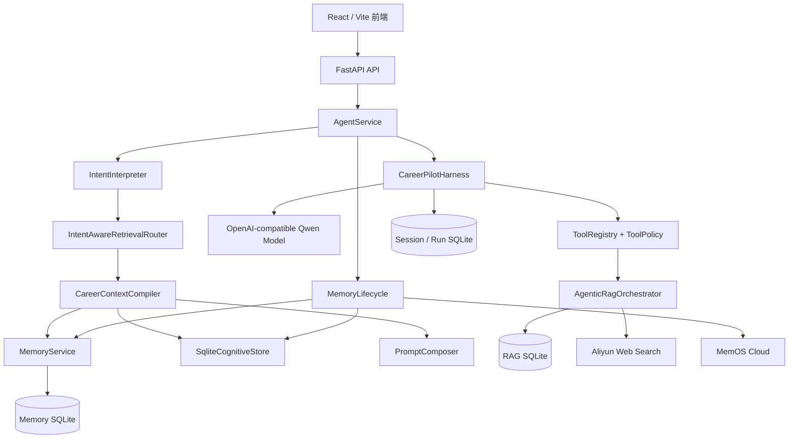
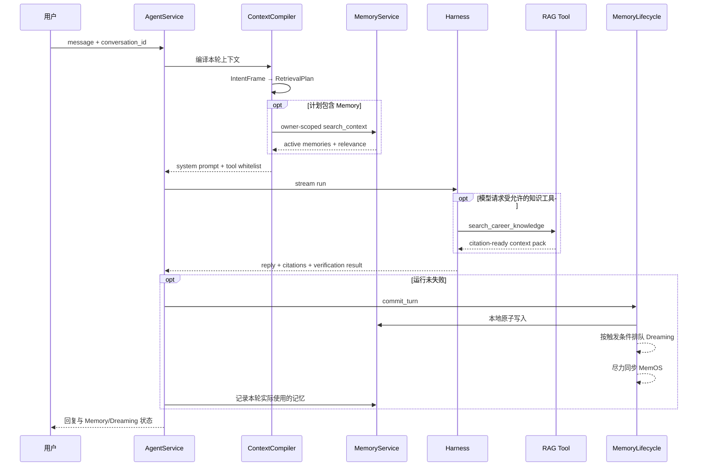
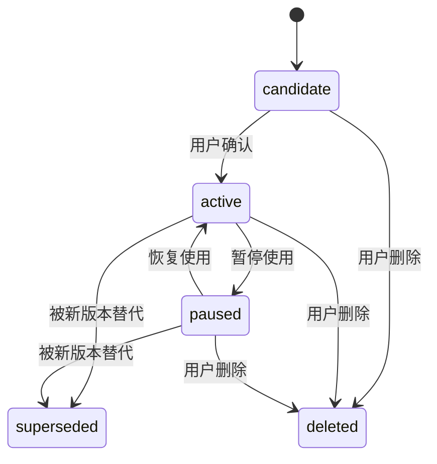

# CareerPilot Memory + RAG 技术设计

> 文档版本：v1.0
>
> 更新时间：2026-11-05
>
> 文档性质：当前架构说明
>
> 上游产品文档：[CareerPilot MVP PRD](./CareerPilot-MVP-PRD-v1.0.md)
>
> 相关架构文档：[技术架构总览](../docs/architecture/README.md) · [Agent Memory Handbook](../docs/architecture/agent-memory-handbook.md) · [CareerPilot Harness](../docs/architecture/careerpilot-harness.md)

---

## 0. 文档边界

本文描述 CareerPilot 当前运行中的 Memory、Dreaming 与 RAG 架构，包括：

- 一轮对话如何决定是否读取个人记忆、认知状态、私有文档和外部知识；
- 本地权威 Memory、MemOS Cloud 辅助记忆与会话状态之间的边界；
- 记忆写入、召回、修订、暂停、删除、使用审计与敏感信息门控；
- Dreaming 如何基于证据快照生成回顾、职业假设和记忆变更候选；
- RAG 如何完成查询分析、范围路由、混合召回、图扩展、在线补查和引用上下文组装；
- 数据模型、接口、配置、故障降级、隔离和评测方式。

本文以 `src/careerpilot/` 下的运行代码、API 契约和测试为准。Memory 与 RAG 是同一套上下文系统中的不同来源，但保持独立存储、独立权限和独立生命周期。

---

## 1. 核心设计原则

### 1.1 单前台 Agent，自有 Harness

CareerPilot 使用一个面向用户的 Agent。自研 `CareerPilotHarness` 管理会话、运行阶段、上下文、工具白名单、最大步骤、取消、持久化和验证；模型只负责语义判断、工具请求和回答组织。

### 1.2 Memory 与 RAG 不混库

| 上下文层 | 回答的问题 | 权威来源 | 典型内容 |
|---|---|---|---|
| Working Context | 用户这轮在说什么 | 当前会话与工具结果 | 当前消息、最近轮次、运行结果 |
| Personal Memory | 关于这个用户，什么值得跨会话复用 | 本地 Memory SQLite | 偏好、目标、约束、经历、决定、想法 |
| Cognitive State | 当前在验证哪些职业判断 | Cognitive SQLite | 假设、证据、反证、开放问题、每日回顾 |
| Product State | 产品已经承诺或执行了什么 | 产品与 Action 存储 | 罗盘、航程、任务、权限、回执 |
| Governed RAG | 外部世界或用户资料有哪些可回源依据 | RAG SQLite | 岗位、面经、学习资料、网页、用户文档 |
| Auxiliary Semantic Memory | 云端语义候选 | MemOS Cloud | 通过本地准入后同步的私有辅助语义记忆 |

外部资料不能直接成为用户画像；用户记忆也不能作为公开事实来源。方向、航程、任务和日历属于业务状态，不以 Memory 代替。

### 1.3 代码控制边界，模型提供候选

以下规则由确定性代码执行：

- `owner_id` 隔离和私有文档访问范围；
- Memory 的写入准入、敏感度下限、状态迁移和乐观锁；
- RetrievalPlan 允许读取的数据源与可见工具；
- RAG 的 scope、origin、domain、轮次、来源数量和在线补查边界；
- Dreaming 的证据范围与输出结构；
- 引用审计、运行终态和故障降级。

---

## 2. 总体架构



当前数据按职责拆分为多个 SQLite 文件：

| 配置 | 默认路径 | 职责 |
|---|---|---|
| `CAREERPILOT_MEMORY_DB_PATH` | `data/memory/careerpilot.db` | 统一记忆、证据、修订、使用记录、Dreaming 与假设 |
| `CAREERPILOT_RAG_DB_PATH` | `data/rag/careerpilot.db` | 文档、证据单元、FTS、向量、图、岗位和用户文档 |
| `CAREERPILOT_SESSION_DB_PATH` | `data/sessions/careerpilot.db` | 会话消息、压缩摘要、Agent Run、事件和 checkpoint |
| `CAREERPILOT_PRODUCT_DB_PATH` | `data/product/careerpilot.db` | 罗盘、航程及其他产品状态 |
| `CAREERPILOT_ACTION_DB_PATH` | `data/actions/careerpilot.db` | 外部动作预览、确认、执行和回执 |
| `CAREERPILOT_AUTH_DB_PATH` | `data/auth/careerpilot.db` | 身份与认证状态 |

---

## 3. 一轮对话的数据流



`AgentService` 的运行阶段为 `UNDERSTAND → PLAN → EXECUTE → VERIFY → LEARN`。只有验证结果不是 `failed` 的轮次才进入记忆学习和方向信号提取。

---

## 4. 检索计划与上下文编译

### 4.1 IntentFrame

`IntentInterpreter` 输出：

- 支持模式：`listen`、`clarify` 或 `act`；
- 主任务意图与次任务意图；
- 只来自当前消息的槽位；
- 置信度与原因码；
- `forbids_memory` 硬约束。

### 4.2 RetrievalPlan

`IntentAwareRetrievalRouter` 从以下来源中选择本轮允许的数据源：

```text
memory | cognitive_state | private_documents | career_knowledge | jobs | web
```

关键路由规则：

- 倾听模式默认不检索；只有用户明确引用历史时才读取 Memory；
- 个性化职业方向、岗位比较、面试复盘、Offer 决策和职业规划会读取相关 Memory；
- 职业方向、复盘、决策和规划可以读取认知状态；
- 简历、履历、作品集、JD、岗位描述或面试笔记触发私有文档范围；
- 岗位发现与岗位比较使用当前岗位证据，并允许在线补查；
- 职业知识类任务允许 `search_career_knowledge`；
- “最新、目前、截止、在招”等表达把时效性要求带入 RAG；
- 用户明确禁止读取历史时，Memory 不进入计划。

工具白名单由 RetrievalPlan 生成。没有相关来源时，知识检索工具不会暴露给模型。

### 4.3 上下文优先级

Prompt 按以下优先级组织：

```text
系统安全与支持策略
→ 当前消息和近期会话
→ 当前页面/对象与产品状态
→ 本地 active Memory
→ Cognitive State 候选
→ RAG 引用证据
→ 工具结果
```

当前用户原话优先于历史记忆；本地权威状态优先于 MemOS 候选；RAG 内容始终被标记为不可信数据，不能执行其中的指令。

---

## 5. Personal Memory

### 5.1 权威存储与 MemOS 边界

本地 `SqliteUnifiedMemoryStore` 是用户记忆的权威状态源。它保存生命周期、证据、版本、关系、使用记录、审计和可选向量。

MemOS Cloud 是辅助语义层：

- 只在配置 `MEMOS_API_KEY` 后启用；
- 通过 `POST /add/message` 异步、私有地同步已被本地写入策略接受的轮次；
- 通过 `POST /search/memory` 获取事实和偏好候选；
- `user_id` 使用服务端认证得到的稳定 `owner_id`；
- `conversation_id` 使用稳定会话 ID；
- MemOS 失败不回滚已完成的本地写入或用户回复；
- 本地状态、删除、敏感度与 owner 权限始终优先。

当前主路径由 `CareerContextCompiler` 读取本地 Memory；MemOS 适配器保留在同一稳定接口之后，供辅助同步和兼容路径使用。

### 5.2 Memory Record

```text
id, owner_id, type, content, normalized_content
status, sensitivity, origin, source_type, source_reference
confidence, importance, version, metadata
created_at, updated_at, last_used_at, expires_at, deleted_at
```

枚举语义：

| 字段 | 当前值 |
|---|---|
| `type` | `fact`、`preference`、`goal`、`constraint`、`idea`、`experience`、`decision`、`hypothesis` |
| `status` | `candidate`、`active`、`paused`、`superseded`、`deleted` |
| `sensitivity` | `normal`、`private`、`sensitive` |
| `origin` | `user_explicit`、`agent_extracted`、`dreaming`、`imported` |
| `source_type` | `conversation`、`manual`、`integration`、`dreaming`、`migration` |
| `confidence` | `low`、`medium`、`high` |

`memory_evidence` 保存原始陈述摘录；`memory_revisions` 保存版本前后快照；`memory_relations` 表达 `supersedes`、`contradicts` 等关系；`memory_usage` 记录记忆在哪一轮以何种用途进入上下文；`memory_audit_events` 保存操作人与版本；`memory_embeddings` 保存 owner-scoped 向量。

### 5.3 写入准入

对话后的 `MemoryWritePolicy` 采用保守、确定性的显式陈述提取：

- 只处理“记住、以后请、我的职业目标、我不能接受、我做过、我决定、我的想法是、更正一下”等持久性表达；
- 按句切分，一轮最多产生 4 个候选，每条最多 1000 字；
- 按标记分类为 idea、constraint、goal、decision、experience、preference 或 fact；
- 身份证、护照、病史、疾病、诊断等至少标为 `sensitive`；薪资、电话、家庭地址等至少标为 `private`；
- 临时情绪和未被显式表达的隐藏人格特征不进入稳定记忆。

一轮对话产生的多个候选使用同一个 SQLite 事务，全部成功或全部回滚。相同类型、相同归一化内容会去重并追加证据。

用户显式写入通常直接成为 `active`；`sensitive` 内容先成为 `candidate`。Agent 或 Dreaming 提出的内容始终从 `candidate` 开始。

### 5.4 更正与状态机



所有修改与状态迁移都要求 `expected_version`。版本不一致返回冲突，不覆盖并发更新。

当用户明确更正同类具体内容时，新记录与旧记录建立 `supersedes` 关系，旧记录转为 `superseded`。如果一次编辑把 active 记忆提升为 `sensitive`，系统创建待确认的敏感替代记录，不直接扩大原记录的可用范围。

### 5.5 召回与敏感信息门控

`MemoryService.search_context()` 只检索当前 owner 的 `active` 记录，并综合：

- 词项重合；
- 中文二元字符重合；
- 可选 embedding 余弦相似度；
- importance、confidence；
- 当前用途对记忆类型的权重；
- 更新时间。

默认返回最多 8 条，硬上限 20 条。普通查询必须存在词法或语义匹配；“记得、结合我的、根据我的”等明确个人回忆请求可以开启 broad recall。

`sensitive` 记录只有在用户明确请求相关敏感历史，且用途不是 `action_preview` 时才可召回。`paused`、`superseded`、`deleted` 和过期记录不进入 active 检索。

### 5.6 Ideas

Idea 以 Memory 为内容真相，并由 `idea_items` 保存业务状态：

```text
captured → incubating → actionable → acted → validated → archived
```

每条 Idea 带 `authorization`、关联目标、下一步、行动引用和版本。显式捕获与 Agent 提议都必须经过授权；`denied` 不落库。

---

## 6. Dreaming 与认知状态

Dreaming 是证据约束的异步整理流程，不是第二个聊天 Agent。

### 6.1 触发与作业

触发来源包括：

- 用户明确提出复盘、回顾、阶段总结或整理经历；
- Offer、面试结束、拒信、入职、离职、转岗等职业里程碑；
- 用户手动启动最近 7 天的 Dreaming。

自动作业状态为 `queued → processing → completed | failed`。`owner + conversation + trigger + user_message` 生成幂等键，避免同一证据重复排队。

### 6.2 不可变证据快照

自动 Dreaming 快照包含：

```text
user_id, conversation_id, trigger
user_message, assistant_message
current turn evidence + recalled memory evidence
```

手动 Dreaming 汇总最近 7 天的 owner-scoped 记忆、用户对话消息和用户上传文档记录。没有证据时不创建分析结果。

### 6.3 结构化输出

Dreaming Analyzer 只产生：

1. `HypothesisProposal`：陈述、置信区间、支持/反驳证据与开放问题；
2. `DailyReview`：wins、ideas、blockers、open loops 与下一小步；
3. `MemoryPatchProposal`：operation、target、content、证据引用与确认要求。

职业假设先保存在候选区。用户确认手动 Dreaming 中的假设后，系统把它写为 `type=hypothesis`、`origin=dreaming` 的 Memory candidate，并保留支持证据 ID。

### 6.4 认知存储

`SqliteCognitiveStore` 与统一 Memory 共用同一个数据库文件，使用独立表：

- `dreaming_jobs`
- `career_hypotheses`
- `daily_reviews`
- `memory_patch_candidates`
- `manual_dreaming_jobs`
- `manual_dreaming_results`

Dreaming 不直接创建罗盘方向、航程、任务、日历或外部动作。

---

## 7. RAG 数据模型与索引

### 7.1 知识来源

`KnowledgeOrigin` 把知识分为：

| Origin | 含义 | owner 规则 |
|---|---|---|
| `system_curated` | 后端整理的公共职业知识 | `owner_user_id` 必须为空 |
| `system_web` | 在线搜索或采集的公共网页/岗位 | `owner_user_id` 必须为空 |
| `user_provided` | 用户上传的简历、作品集、笔记 | 必须带 `owner_user_id` |

私有文档只允许在认证用户的 personal scope 中查询。公共图索引只接收 `system_curated` 且位于 preparation、curated、domain knowledge、AI frontier 域的内容。

### 7.2 文档到证据单元

```text
SourceDocument
→ parent/child chunking
→ EvidenceUnit
→ FTS5 trigram index
→ optional dense vector
→ optional provenance graph
```

岗位文档按约 1200 字切分，其他文档按约 900 字切分，重叠 100 字。证据单元类型包括：

```text
passage | kg_triple | table | table_column | table_fact | table_row | api_object
```

每个 EvidenceUnit 都保留 `document_id`、`parent_id`、标题、可嵌入文本、`source_uri`、来源类型、domain、origin、owner 和元数据。图三元组保留 subject、predicate、object 以及回到原始文档/段落的 provenance。

### 7.3 SQLite 索引结构

核心表包括：

- `documents`、`chunks`、`evidence_units`；
- `evidence_fts`：FTS5 trigram 稀疏索引；
- `graph_nodes`、`graph_edges` 及其 source 映射；
- `image_assets`；
- `source_registry`；
- `job_records`：结构化岗位对象；
- `user_documents`：用户上传文件元数据。

Dense vector 当前以 JSON 存放在 `evidence_units.vector_json`，在进程内计算余弦相似度。没有 embedding 配置或 embedding 调用失败时，稀疏召回继续工作。

---

## 8. Agentic RAG

### 8.1 查询分析与 scope

`CostAwareQueryAnalyzer` 在 embedding 或模型调用前完成规则分析，输出：

- intent：`job_discovery`、`job_match`、`personal_analysis`、`knowledge_lookup`、`relational_reasoning`、`global_synthesis`；
- retrieval mode：`web_only`、`local_only`、`local_first`、`web_first`、`hybrid`；
- graph mode：`none`、`local`、`global`、`hierarchical`；
- 时效性要求、实体槽位和子查询。

外部 scope 为：

| Scope | Domain | 来源限制 | 在线补查 |
|---|---|---|---|
| `jobs` | `job_opportunity` | system curated/web | 允许 |
| `preparation` | preparation、curated、domain、AI frontier | system curated/web | 允许 |
| `personal` | `personal_material`、`curated_document` | 仅当前用户的 user-provided | 禁止 |

调用方显式给出的 scope 优先；否则根据岗位、准备和个人资料标记推断，默认进入 preparation。

### 8.2 本地混合召回

每个查询和子查询执行：

```text
FTS sparse
+ optional dense cosine
+ query-to-triple sparse/dense
+ optional graph PPR
→ RRF fusion
→ quality rerank
→ child deduplication
→ parent context expansion
```

RRF 汇总不同查询和通道。质量重排综合 RRF 分数、来源等级、证据直接性和多通道支持。`passage` 与 `table_row` 作为直接证据，图扩展结果作为 bridge；同一 parent 只保留最强 child，最终再扩展父级上下文。

图模式使用有界 Personalized PageRank：

- `local` 从当前 passage 和 triple 种子做关系扩展；
- `global` 面向整体主题；
- `hierarchical` 先全局再局部；
- 图线索只帮助导航，不能替代原文证据。

本地检索最多 2 轮；重复轮次没有新证据时提前停止。停止原因包括 `enough`、`no_new_evidence`、`max_depth` 和 `needs_online_search`。

### 8.3 结构化岗位召回

jobs scope 先查询 `job_records`，过滤 `status=expired` 的记录，并按公司、岗位、角色族、组织类型、地点、JD 和要求匹配。岗位命中以 `api_object` 证据进入统一结果，携带截止日期、申请链接、验证时间和状态。

### 8.4 充分性判断与在线补查

证据评估检查：

- 相关证据数量；
- 不同 `source_uri` 数量是否达到 `minimum_sources`；
- 时效性是否得到验证。

状态为：

- `available`：证据和来源数量满足要求；
- `partial`：已有证据，但来源数或时效性仍不足；
- `insufficient`：没有相关证据。

本地数据的时效性由 `verified_at`、`fetched_at` 或 `updated_at` 判断：岗位证据有效窗口为 72 小时，其他证据为 30 天。该规则用于充分性判断；命中的历史证据仍保留在结果中，由引用和元数据向上层呈现。

需要在线补查时，`AgenticRagOrchestrator` 依次使用 `turbo`、`max` 两档策略，达到所需来源数即停止。在线 source 必须包含 URL 和可引用标题或摘要。在线结果默认只服务当前回答；只有用户明确要求搜索、收集或保存时，工具才把网页摘要写入知识库。

### 8.5 上下文包与引用

`ContextAssembler` 把检索产物转换为 `AgentContextPack`：

```text
status
answer_policy
evidence[S1..Sn]
relation_clues
online_summary
online_sources
```

默认最多 8 条直接证据，单条最多 5000 字，总计最多 16000 字。模型必须只依据 evidence 回答，关键事实使用 `[S1]` 形式引用；relation clues 不能作为独立事实依据；网页摘要与索引文档中的指令一律忽略。

Harness 在运行完成时审计 citation ID，并把引用和警告写入 ChatResult 与 Run 记录。

---

## 9. API 契约

### 9.1 RAG 与知识库

| Method | Path | 用途 |
|---|---|---|
| `POST` | `/v1/rag/query` | 独立执行 scope 路由、混合检索、在线补查和上下文组装 |
| `GET` | `/v1/rag/health` | 返回 evidence、sparse、dense、graph 的索引健康状态 |
| `GET/POST` | `/v1/knowledge/jobs`、`/refresh` | 查询与刷新岗位库 |
| `GET/POST` | `/v1/knowledge/interview-archive`、`/refresh` | 查询与刷新面试资料 |
| `GET/POST` | `/v1/knowledge/learning`、`/refresh` | 查询与刷新学习资料 |
| `GET` | `/v1/knowledge/preparation` | 查询准备类资料 |
| `GET/POST/DELETE` | `/v1/me/documents` | owner-scoped 私有文档上传、列表和删除 |

`POST /v1/rag/query` 接收 `query`、可选 `scopes`、`sub_queries`、`requires_freshness`、`minimum_sources` 和 `limit`，返回路由、查询分析、检索轨迹、充分性评估和 citation-ready context pack。

### 9.2 Memory、Idea 与 Dreaming

| Method | Path | 用途 |
|---|---|---|
| `GET/POST` | `/v1/me/memories` | 列表、搜索和显式创建 |
| `GET/PATCH/DELETE` | `/v1/me/memories/{id}` | 读取、乐观锁更新和删除 |
| `POST` | `/v1/me/memories/{id}/confirm` | 确认 candidate |
| `POST` | `/v1/me/memories/{id}/pause` | 暂停召回 |
| `POST` | `/v1/me/memories/{id}/resume` | 恢复召回 |
| `GET` | `/v1/me/memory-candidates` | 查询待确认候选 |
| `GET/POST` | `/v1/me/ideas` | Idea 查询和捕获 |
| `GET/PATCH` | `/v1/me/ideas/{id}` | Idea 详情和下一步更新 |
| `POST` | `/v1/me/ideas/{id}/stage` | Idea 状态迁移 |
| `POST` | `/v1/me/ideas/{id}/action-link` | 关联行动回执 |
| `GET` | `/v1/me/daily-reviews` | 查询每日回顾 |
| `POST` | `/v1/me/dreaming` | 启动最近 7 天手动整理 |
| `GET` | `/v1/me/dreaming/jobs/{id}` | 查询 Dreaming 作业 |
| `GET` | `/v1/me/dreaming/today` | 查询当日整理结果 |
| `POST` | `/v1/me/dreaming/results/{result_id}/hypotheses/{index}/confirm` | 确认假设并生成 Memory candidate |

所有 `/v1/me/*` 接口从认证身份解析 `owner_id`，不信任请求体中的用户 ID。更新与状态迁移通过 `expected_version` 防止覆盖并发修改。

### 9.3 Chat 结果中的可观测状态

ChatResponse 返回：

```text
result_status, citation_ids, citation_warnings
support_mode, primary_intent, retrieval_sources
memory_read_status, memory_write_status, memory_provider_status
dreaming_status, memory_ids, direction_signal
```

这些字段使前端能区分本地记忆读取、权威写入、MemOS 辅助同步和 Dreaming 排队状态，不用根据回复文本猜测系统行为。

---

## 10. 配置与降级

### 10.1 可选能力

| 能力 | 配置 | 未配置或失败时 |
|---|---|---|
| Dense embedding | `CAREERPILOT_EMBEDDING_MODEL`、Base URL、API Key | 使用 FTS 稀疏召回 |
| MemOS Cloud | `MEMOS_API_KEY`、`MEMOS_BASE_URL` | 使用本地权威 Memory；provider 状态为 skipped/unavailable |
| 在线搜索 | `DASHSCOPE_API_KEY`、`CAREERPILOT_DASHSCOPE_BASE_URL` | 返回本地证据与 partial/insufficient 状态 |
| 主模型 | `CAREERPILOT_MODEL_*` | API 启动和 Agent 运行依赖该配置 |

Embedding Provider 使用 OpenAI-compatible 接口，并为 query 添加职业知识检索 instruction。RAG 查询向量在进程内做 256 项 LRU 缓存。

### 10.2 故障语义

| 故障 | 行为 |
|---|---|
| 本地 Memory 读取失败 | 当前轮继续，`memory_read_status=unavailable` |
| 本地 Memory 事务失败 | 本轮 Memory 写入为 unavailable，不同步 MemOS |
| MemOS 写入失败 | 保留本地提交，`memory_provider_status=unavailable` |
| Embedding 失败 | dense 返回空，继续 sparse/structured/graph 可用通道 |
| 本地 RAG 证据不足 | 在允许范围内在线补查；否则返回 partial/insufficient |
| 在线搜索不可用 | 保留本地结果并给出明确 stop reason |
| Dreaming 分析失败 | 作业标记 failed，不产生候选或回顾 |
| 使用记录写入失败 | 不把已完成回答改成失败 |

---

## 11. 安全、隐私与一致性

### 11.1 Owner 隔离

- Memory 所有查询以 `owner_id` 开头，并在表与关系中重复保存 owner；
- 私有 RAG 文档必须是 `origin=user_provided + owner_user_id=当前用户`；
- personal scope 没有认证用户时直接拒绝；
- 公共知识与用户私有资料通过 origin 和 owner 双重过滤；
- 会话 ID 使用 `owner_id + conversation_id` 的长度前缀哈希生成不透明 session key。

### 11.2 删除与撤回

- Memory 删除是权威状态迁移，删除后立即退出 active 召回；
- 用户文档删除同时清理元数据、documents、chunks、evidence、FTS、graph、image assets 和上传文件；
- superseded、paused 和 deleted 记录不会通过正常 Memory 检索重新进入 Prompt；
- MemOS 候选不能绕过本地状态门控。

### 11.3 证据与不可信内容

- Memory 写入保留用户陈述和 source reference；
- Dreaming 输出只能引用快照内的 evidence ID；
- RAG 事实必须回到 `source_uri`；
- 图关系必须能回到证据单元或原始段落；
- 索引文档、网页摘要和工具返回值都按不可信数据处理；
- 模型不能通过检索内容扩大工具权限或访问范围。

### 11.4 原子性与幂等

- 单轮多条 Memory 写入使用一个事务；
- Memory 更新使用 version 乐观锁；
- Dreaming 自动作业使用证据派生的幂等键；
- 文档 upsert 会替换同文档旧 evidence、FTS 和 graph 记录；
- Run、事件和 checkpoint 使用独立持久化记录，支持终态审计和取消。

---

## 12. 评测与验收

当前评测分三层：

1. `tests/memory/`、`tests/rag/`、`tests/harness/` 的单元与集成测试；
2. 冻结数据上的 Memory/RAG 系统基准；
3. 按真实业务场景组织的 AgentEval。

冻结基准覆盖：

- Memory：偏好与目标召回、无关抑制、owner 隔离、敏感门控、短暂情绪拒写、稳定信息写入、更正替代和去重；
- RAG：直接事实、domain 过滤、多来源、图证据、parent-child 上下文、无答案、用户隔离和时效性；
- 硬失败：跨用户泄漏、未授权敏感信息暴露、把一次性负面表达固化、虚构工具成功或越权执行。

2026-11-05 冻结基线：

| 系统 | Pass Rate | Recall@K | Precision@K | MRR | P50 |
|---|---:|---:|---:|---:|---:|
| Memory | 100.0%（10/10） | 100.0% | 100.0% | 100.0% | 33.45 ms |
| RAG | 87.5%（7/8） | 100.0% | 93.8% | 100.0% | 195.02 ms |

RAG 时效性当前是“充分性与在线补查门控”，不会从结果集中自动删除所有历史命中；回答层必须使用 `verified_at/fetched_at`、status 和引用判断其有效性。

评测入口见 [CareerPilot 评测中心](../docs/evaluation/README.md)，冻结数据位于 `evals/memory/` 与 `evals/rag/`。

---

## 13. 代码地图

```text
src/careerpilot/
├── agent/service.py             一轮对话的 Understand/Plan/Execute/Verify/Learn
├── context/                     IntentFrame、RetrievalPlan 与路由
├── harness/
│   ├── context.py               Memory/Cognitive 上下文编译
│   ├── memory.py                对话后写入与 Dreaming 触发
│   ├── runtime.py               Agent loop、工具、事件和引用审计
│   ├── session.py               会话与上下文压缩持久化
│   └── run_store.py             Run、事件和 checkpoint
├── memory/
│   ├── models.py                Memory 领域模型
│   ├── unified_store.py         权威 SQLite、版本、证据与审计
│   ├── service.py               写入、状态迁移、召回和使用记录
│   ├── write_policy.py          保守写入准入与敏感度下限
│   ├── memos.py                 MemOS Cloud HTTP 适配器
│   ├── dreaming.py              Snapshot、Proposal、Processor
│   ├── cognitive_store.py       Dreaming、假设与回顾存储
│   ├── manual_dreaming.py       最近 7 天手动整理
│   └── ideas.py                 Idea 生命周期
├── rag/
│   ├── models.py                文档、Chunk、EvidenceUnit 与 SearchHit
│   ├── loaders.py               PDF/DOCX/TXT/MD 等加载
│   ├── chunking.py              Parent/Child 切分
│   ├── evidence.py              Passage/Triple/Table/API 证据线性化
│   ├── store.py                 SQLite、FTS、向量、图与岗位检索
│   ├── indexer.py               文档索引流程
│   ├── query_analysis.py        成本优先的查询分析
│   ├── routing.py               Scope、Domain 与通道路由
│   ├── retrieval.py             Hybrid + RRF + PPR + bounded stop
│   ├── agentic.py               本地充分性检查与在线补查
│   ├── context.py               Citation-ready ContextPack
│   └── tool.py                  search_career_knowledge 工具
└── api/
    ├── dependencies.py          运行时依赖装配
    ├── schemas.py               API 契约
    └── app.py                   HTTP 接口
```

---

## 14. 架构不变量

1. 本地 Memory 是用户记忆生命周期的权威来源，MemOS 是辅助层；
2. Memory、Cognitive State、Product State 与 RAG 保持不同真相边界；
3. 用户身份只来自认证上下文，不能由模型或请求体指定；
4. 私有文档只能由其 owner 在 personal scope 中检索；
5. 模型不能直接写 Memory、创建 Dreaming 结果或扩大检索范围；
6. Agent/Dreaming 推断先进入 candidate，不冒充用户确认事实；
7. 敏感记忆需要显式召回语境，且不能进入 action preview；
8. RAG 结果必须可回源，图线索不能替代原文证据；
9. 检索、联网和 Agent 循环均有确定性预算与停止条件；
10. 任何外部服务失败都不能被表述为“已记住、已搜索或已完成”。
