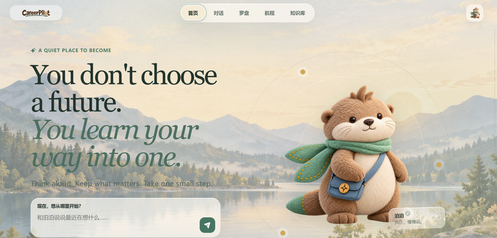

<div align="center">

# CareerPilot

### 把零散的想法，慢慢走成自己的职业方向。

**一个为高校学生与毕业早期青年设计的长期就业陪伴 Agent。**<br>
它不急着替你选答案，而是陪你理解自己、验证方向，并迈出下一小步。

[](https://careerpilot.pages.dev)
[](./frontend)
[](./src/careerpilot)
[](./docs/architecture/careerpilot-harness.md)

### [打开 CareerPilot 在线体验 →](https://careerpilot.pages.dev)

[产品介绍](#为什么是-careerpilot) · [核心体验](#核心体验) · [工作方式](#它如何陪你向前) · [本地运行](#本地运行)

</div>

[](https://careerpilot.pages.dev)

> **You don't choose a future. You learn your way into one.**<br>
> 想法可以先不完整，方向也可以边走边调整。CareerPilot 会记住真正重要的线索，把对话、现实证据与小行动连接成一条持续生长的路。

---

## 为什么是 CareerPilot

很多职业产品从“你要找什么工作”开始，CareerPilot 从“你最近在想什么”开始。

当职业方向还没有收敛时，真正困难的往往不是缺少岗位列表，而是：不知道自己适合什么、分不清焦虑和真实偏好、收藏了很多信息却迈不出下一步。CareerPilot 希望成为这段不确定时期里的安静陪伴者，帮助你完成两件长期发生、彼此影响的事：

- **慢慢看清自己**：把零散想法、现实体验、偏好、顾虑和尝试结果，整理成可以持续修正的职业认知。
- **继续向前行动**：先接住情绪，再把模糊念头变成一个低压力、可验证的小行动，根据真实反馈调整方向。

CareerPilot 不是替你做职业决定的“答案机器”，也不以尽快推荐更多岗位为第一目标。它更像一个了解上下文、尊重节奏、会和你一起复盘的长期伙伴。

## 核心体验

| 页面 | 你可以做什么 |
|---|---|
| **首页** | 从一句当下的想法开始，看到今天值得关注的小行动与进展。 |
| **对话** | 在倾听、整理、探索和行动四种模式间自然切换；情绪需要被接住时，不会被强行推向任务。 |
| **罗盘** | 把职业猜想、支持证据、反例与信心变化放在一起，方向不再只是一个模糊标签。 |
| **航程** | 将想法推进为实验、任务和现实反馈，留下真正走过的足迹。 |
| **知识库** | 聚合岗位、学习资料与个人材料，让建议有来源，也与你本人有关。 |

## 它如何陪你向前

```text
随手表达
   ↓
被理解与整理
   ↓
形成一个可验证的职业猜想
   ↓
在你确认后，生成一个足够小的行动
   ↓
记录现实反馈，更新记忆与方向
   ↓
在每日回顾中看见变化
```

这条闭环背后有四个产品原则：

1. **情绪优先于效率**：难受时先陪你停一下，不把“能行动”误判成“应该立刻行动”。
2. **证据优先于标签**：方向来自经历、偏好与现实反馈，而不是一次测试给出的固定结论。
3. **记忆服务于成长**：只保留稳定偏好、长期约束和明确值得记住的内容；一次性的自责不会成为永久标签。
4. **行动始终由你确认**：外部写操作遵循预览、确认、执行、验证的边界，Agent 不替你偷偷做决定。

## 泊泊：不催促你的同行者

泊泊是 CareerPilot 里的陪伴角色。它会根据情境倾听、整理、探索或行动，但始终保持同一种态度：允许不确定，尊重你的选择，并把复杂问题收束成一个可以开始的小步骤。

你可以这样开始：

> “我好像对 AI 产品有兴趣，但不知道是喜欢这个方向，还是只是害怕错过。”

CareerPilot 不会直接给出一个职业结论，而会先帮你区分兴趣、能力、现实约束与焦虑，再提出可以被现实验证的下一步。

## 当前版本

CareerPilot 目前处于 **MVP 阶段**，已经打通从表达、理解、职业假设、行动到回顾的核心体验。

- 四种支持模式：`listen` / `organize` / `explore` / `act`
- 基于上下文的长期记忆、Idea 生命周期与每日回顾
- 岗位、学习资料和个人文档组成的统一知识入口
- 本地证据不足时的受控联网检索
- 飞书、WPS 与网易邮箱连接能力及人工确认边界
- React 产品前台与 FastAPI Agent 服务

> 在线版本用于产品体验与 MVP 验证。当前身份隔离仍基于匿名 Cookie，不等同于正式账号体系；请勿上传敏感个人材料或将其作为生产级多租户服务使用。


<details>
<summary><strong>技术架构</strong></summary>

CareerPilot 是一个单前台 Agent、Memory/RAG-native 的自有 Harness。模型负责语义理解与工具选择，权限、最大步数、Session、记忆准入、检索边界和外部动作确认由确定性代码控制。

```text
React / Vite 产品前台
          │
          ▼
FastAPI ── AgentService
             ├─ CareerContextCompiler
             ├─ CareerPilotHarness（model → tool → model）
             ├─ Unified Memory / Idea / Dreaming
             ├─ Agentic RAG（local → turbo → max）
             └─ Action Service（preview → confirm → apply → verify）
```

主要目录：

```text
frontend/                React 产品前台
src/careerpilot/
├── agent/               Agent 定义、Prompt 与 Turn 编排
├── context/             意图识别与检索路由
├── harness/             模型/工具循环、Session 与工具策略
├── memory/              长期记忆、Idea 与每日回顾
├── rag/                 统一证据索引与混合召回
├── actions/             授权、预览、确认、执行与验证
├── connectors/          飞书、WPS、网易邮箱适配器
└── api/                 FastAPI 路由与 Schema
```

</details>

## 延伸阅读

- [产品需求：CareerPilot MVP](PRD/CareerPilot-MVP-PRD-v1.0.md)
- [意图与任务拆解](PRD/CareerPilot-Intent-and-Task-Decomposition-PRD-v0.1.md)
- [Memory 与 RAG 技术设计](PRD/CareerPilot-Memory-RAG-Technical-Design.md)
- [CareerPilot Harness 架构](docs/architecture/careerpilot-harness.md)

---

<div align="center">

**方向不是一次选出来的，而是在一次次真实尝试中长出来的。**

[现在就和泊泊聊聊 →](https://careerpilot.pages.dev)

</div>
